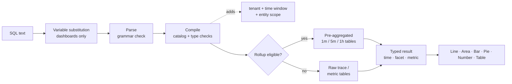

## 如何使用SQL進行查詢：查詢的機制 {#how-to-query-with-sql-the-mechanics-of-querying}

在使用任何工具之前，先瞭解其運作方式會有所幫助。 本檔案說明如何探索您的資料、說明查詢執行時會發生什麼情況，並逐步說明從簡單到複雜的範例查詢。

### 資料探索

使用SQL的最佳方式是開啟&#x200B;**探索**，並在您自己的資料上試用。

> **提示**
>
> SQL是唯讀的。 它無法變更或刪除資料，而且每個查詢的範圍都屬於您的租使用者。

1. **在應用程式頂端的租使用者切換器中挑選客戶**，SQL需要單一租使用者。
2. 開啟&#x200B;**探索**。 **視覺化產生器**&#x200B;索引標籤可讓您挑選&#x200B;**來自** （實體）、**彙總**、**篩選器**、**面向**&#x200B;和&#x200B;**時序**。 產生的SQL會顯示在下方。
3. 切換至&#x200B;**SQL**&#x200B;索引標籤以直接編輯查詢。 編輯器會在您鍵入時自動完成實體、屬性和函式。
4. 開啟右側的&#x200B;**查詢指南**&#x200B;面板，以瀏覽實體、屬性型別和範例查詢。 按一下範例以載入。
5. 按一下&#x200B;**驗證**&#x200B;以檢查查詢而不執行它，或按一下&#x200B;**執行** (⌘/Ctrl + Enter)以檢視結果。

首先，輸入`FROM`並選擇實體，然後新增`SELECT`和屬性：

```sql
FROM Transaction SELECT name, duration LIMIT 20
```

這是基本的&#x200B;**事件查詢**。 它會傳回20個傳入請求，並顯示每個請求的作業名稱和持續時間。

現在以&#x200B;**彙總**&#x200B;取代屬性，並將結果分組：

```sql
FROM Transaction SELECT count(*) FACET service
```

這會計算每個服務的請求數，以顯示您要報告的服務。

> **重要**
>
> **在您建置之前探索。** 屬性可用性取決於每項服務的檢測方式。 先在新租使用者上執行[探索查詢](../../examples/query-cookbook.md#data-discovery)，以檢視哪些服務、主機、屬性和量度實際包含資料。

### 查詢的執行方式

當您執行查詢時，可觀察性深入分析：

1. **取代變數**，將`{{name}}`代號取代為目前儀表板變數選取專案。 此操作只會在瀏覽器中的控制面板上進行。
2. **剖析**&#x200B;文字。 SQL文法以外的任何專案都會遭到拒絕，包括分號、原始SQL函式和子查詢。
3. **編譯**&#x200B;查詢。 它將每個邏輯屬性（例如`urlPath`）對應到其儲存的運算式，並驗證型別和函式。
4. **新增強制警衛**：您的租使用者、時間視窗和實體的固定範圍（例如，`Transaction`表示伺服器僅涵蓋範圍）。
5. **將**&#x200B;個符合條件的時間序列查詢路由到預先彙總的&#x200B;**統計**&#x200B;資料表。 這是自動的，且結果與原始資料相符。
6. **以15秒逾時和位元組讀取預算執行**&#x200B;查詢，然後傳回UI轉譯的輸入欄（時間、Facet、量度）。



### 結果圖形

每個查詢都會傳回四個圖形之一。 形狀決定哪些圖表有意義。

| 形狀 | 如何取得 | 預設`LIMIT` | 最佳視覺效果 |
| --------------- | ---------------------------------------------------- | --------------- | ------------------ |
| **公告牌** | 僅限彙總，無`FACET`且無`TIMESERIES` | 1 | 數字 |
| **Facet** | 彙總+ `FACET` | 10 | 長條圖、圓形圖、表格 |
| **時間序列** | 彙總+ `TIMESERIES` （無論是否有`FACET`） | 5,000列 | 線條、區域、長條圖 |
| **個活動** | 僅限原始屬性 | 100 | 表格 |

<a id="time-window-precedence"></a>

### 時間視窗優先順序

| 查詢執行的位置 | 適用哪個視窗 |
| --------------------------------- | ---------------------------------------------------------------------------------- |
| **儀表板Widget** | 儀表板&#x200B;**時間選擇器**。 已忽略查詢中的`SINCE`/`UNTIL`。 |
| **新增Widget預覽** | **新增Widget**&#x200B;對話方塊中的時間選擇器。 |
| **探索** | 全域時間選擇器。 選取器範圍作用中時會忽略`SINCE`/`UNTIL`。 |
| **沒有明確範圍的API** | `SINCE`/`UNTIL`在查詢中，預設為過去一小時。 |

> **附註**
>
> 由於選擇器會在控制面板和Explore中獲勝，因此本指南通常會將`SINCE`排除在控制面板查詢之外。 使用者應該一律為查詢定義時間選擇器。
