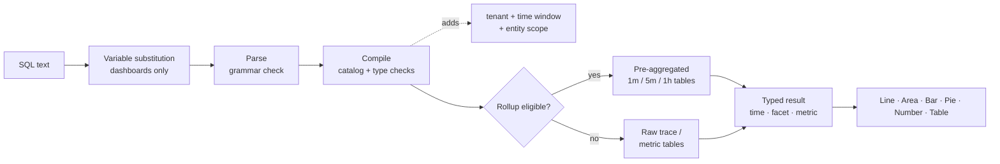

<a id="top"></a>

# Adobe Observability Insights控制面板/查詢檔案

**Adobe Observability Insights Query Language (SQL)** — 在Adobe Observability Insights中查詢、圖表和儀表板。

|                |                                                                  |
| -------------- | ---------------------------------------------------------------- |
| **套用至** | 深入分析UI → **探索**&#x200B;和&#x200B;**儀表板** （自訂儀表板） |
| **客群** | 瞭解SQL的工程師、SRE和進階使用者 |

>[!TIP]
> 每個標示為`sql`的程式碼區塊都是SQL查詢，您可以將其直接貼到&#x200B;**探索→的SQL**&#x200B;或&#x200B;**儀表板→新增Widget→SQL**。

## 檔案地圖

| 區段 | 檔案 | 將了解的內容 |
| --------------- | ----------------------------------------------------------------------------------- | ------------------------------------------------------------------------------------------- |
| **開始使用** | [1. 開始使用SQL](#1-get-started-with-SQL-the-language-of-your-telemetry) | 什麼是SQL、您可以查詢什麼、在哪裡使用它、基本規則 |
|                 | [2. 如何使用SQL](#2-how-to-query-with-SQL-the-mechanics-of-querying)查詢 | 如何探索資料、查詢如何執行、運作範例 |
|                 | [3. 圖表和控制面板](#3-charts-and-dashboards-visualizing-your-data) | 如何將查詢轉換為圖表並逐步建置儀表板 |
| **參照** | [4. SQL參考](#4-SQL-reference) | 每個子句、函式和運運算元，包含範例 |
|                 | [5. 資料字典](#5-data-dictionary) | 您可以查詢的每個實體和屬性 |
| **教學課程** | [6. 教學課程1：您的第一個查詢](#6-tutorial-1-your-first-queries) | `SELECT`，`FROM`，`LIMIT`，彙總，時間，`TIMESERIES`，`WHERE`，`FACET` |
|                 | [7. 教學課程2：控制您的資料](#7-tutorial-2-control-your-data) | 唯一值、最新/最早、百分比、百分位數、標籤、萬用字元、排序 |
|                 | [8. 教學課程3：推進您的儀表板](#8-tutorial-3-advance-your-dashboarding) | 條件式彙總、Apdex、比率、長條圖、公式、變數、區段 |
|                 | [9. 教學課程4：進階函式](#9-tutorial-4-advanced-functions) | `stddev`，`derivative`，排名`latest`，總計份額，範圍組合，量度探索 |
| **範例** | [10. 查詢逐步指南](#10-query-cookbook) | 依主題（包括AEM）提供100多個現成可用的查詢 |
|                 | [11. 儀表板Blueprint](#11-dashboard-blueprints) | 包含每個Widget查詢的十個完整、複雜儀表板 |
| **操作** | [12. 效能](#12-performance) | 統計、查詢預算以及如何讓儀表板保持快速 |
|                 | [13. 疑難排解](#13-troubleshooting) | 每個錯誤訊息、其含義以及如何加以修正 |
|                 | [14. 附錄](#14-appendix) | 限制、匯出檔案格式、單頁速查表 |

&#x200B;# 快速入門

## &#x200B;1. 開始使用SQL：遙測的語言

SQL是類似SQL的查詢語言，用於您的Observability Insights資料。 這是每個自訂儀表板Widget和&#x200B;**瀏覽**&#x200B;頁面背後的相同語言，因此您可以建立團隊需要的檢視。

SQL與&#x200B;**個實體**&#x200B;搭配使用，這些實體是好記的邏輯檢視，例如`Transaction`、`Span`或`CpuUtilization`。 您絕對不會直接查詢儲存空間表格。 「可觀察性深入分析」會將每個SQL查詢編譯為安全、引數化的倉儲查詢。 它一律限定查詢租使用者的範圍和所選的時間範圍。

```sql
SELECT count(*) AS requests FROM Transaction TIMESERIES AUTO
```

### 您可以使用SQL做什麼

使用SQL可以：

- **建置圖表**&#x200B;的輸送量、錯誤率、延遲、Apdex、CPU、記憶體、JVM棧積、磁碟和網路隨時間變化。
- **回答特定問題**，例如「發佈層級上的哪些URL路徑的p95值最差？」 或「哪個下游網域失敗？」
- **從KPI向下鑽研至個別要求與追蹤ID，以調查事件**。
- **使用KPI、趨勢、表格、公式、附註、區段標題和變數建立儀表板**。
- **使用Sling、JSP、JCR、Dispatcher和AEM屬性來分析GraphQL工作負載** (Adobe Experience Manager)。

SQL同時支援&#x200B;**事件查詢** （傳回個別要求列）和&#x200B;**彙總查詢** （傳回總計、百分位數、比率、劃分和時間序列）。

>[!TIP]
> **儀表板→建立儀表板**&#x200B;中的範本完全由SQL建置。 開啟任何具有鉛筆圖示的範本Widget，以檢視其查詢並從中學習。

### 您可以查詢的內容

SQL可以查詢四個資料系列。 完整清單位於[資料字典](#5-data-dictionary)中。

| 家庭 | 實體 | 常見問題 |
| ------------------------------------ | ------------------------------------------------------------------------------------------------------------------------------------------------------------------ | -------------------------------------------------------------------- |
| **追蹤(APM)** | `Transaction` （傳入要求）、`AppRequest` （要求+訊息消費者）、`Span` （每個範圍） | 輸送量、延遲、錯誤、Apdex、下游呼叫、AEM程式碼路徑 |
| **已組織的主機和執行階段量度** | `CpuUtilization`、`MemoryUtilization`、`LoadAverage5m`、`DiskUtilization`、`NetworkReceiveRate`、`JvmHeapUsed`、`JvmThreadCount`、`DispatcherRequestRate`等 | 飽和度、容量、JVM健全狀態、Dispatcher負載 |
| **一般量度** | `MetricGauge`, `MetricSum` | 依名稱、測量結果探索分類的任何OpenTelemetry測量結果 |
| **預先彙總的跨區組合** | `SpanBreakdown` | 構成交易的子作業 |

>[!NOTE]
> 記錄、警示定義和詳細目錄關係無法使用。

### SQL的使用位置

| 位置 | 如何開啟 | 用途 |
| ----------------------- | ------------------------------------------------------------------------------ | ------------------------------------------------------------------------------------------------------------------------------------------------------------------------------------ |
| **探索** | 左側導覽→**瀏覽** | 臨機分析。 使用&#x200B;**視覺化產生器**&#x200B;或&#x200B;**SQL**&#x200B;索引標籤，**驗證**，然後&#x200B;**執行** (⌘/Ctrl + Enter)。 包含&#x200B;**歷程記錄**&#x200B;和&#x200B;**已儲存**&#x200B;的查詢以及&#x200B;**查詢指南**&#x200B;面板。 |
| **儀表板** | 左導覽→**儀表板**→開啟或建立儀表板→**新增Widget** | 結合到儀表板中的持續性圖表、KPI和表格。 |
| **公式Widget** | **將Widget新增→公式** | 結合2到6個SQL查詢與算術（比率、淨餘空間、燒錄率）。 |
| **儀表板變數** | 從查詢&#x200B;**→取的**+變數 | 從SQL `FACET`查詢的不同值填入選取器。 |
| **查詢檢查** | 將游標暫留在圖表→檢查查詢 | 檢視內建或儀表板圖表背後的SQL。 |

### SQL查詢結構

SQL遵循以子句為基礎的語法。 此查詢會計算所選視窗中的所有入站請求：

```sql
SELECT count(*) FROM Transaction
```

以下是所有可用的條款：

```text
SELECT  function(attribute) [FILTER (WHERE condition)] [AS alias] [, ...]
        | attribute [AS alias] [, ...]
FROM    Entity
  [WHERE      condition [AND | OR ...]]
  [FACET      attribute [, attribute ...]]        -- up to 5
  [SINCE      n unit [AGO]]
  [UNTIL      NOW | n unit [AGO]]
  [TIMESERIES AUTO | MAX | n unit]
  [ORDER BY   alias [ASC | DESC]]
  [LIMIT      number]                              -- 1 to 5000
```

SQL遵循的規則如下：

| 規則 | 詳細資料 |
| ---------------------------- | ------------------------------------------------------------------------------------------------------------------------------------------------------------------------------------ |
| **必要的子句** | 需要`SELECT`和`FROM`。 其他每個子句都是選擇性的。 您可以以下列任一專案開頭： `FROM Transaction SELECT count(*)`也是有效的。 |
| **子句順序** | `FROM`之後的子句可以任何順序出現。 每個子句只能出現一次。 |
| **查詢大小** | 查詢大小必須等於或少於4 KB。 |
| **區分大小寫** | 關鍵字、函式名稱、實體名稱和屬性名稱是&#x200B;**不區分**&#x200B;大小寫。 字串值&#x200B;**有**&#x200B;區分大小寫(`'Error'` ≠ `'error'`)。 |
| **字串** | 使用單引號： `WHERE status = 'Error'`。 若要包含引號，請加倍引號： `'O''Brien'`。 不接受雙引號。 |
| **常值** | 字串、數字（包括負數與小數）、`TRUE`、`FALSE`、`NULL`。 |
| **屬性名稱** | 名稱可以包含字母、數字、`_`和`.` （例如`http.statusCode`）。 不需要反引號。 |
| **彙總與屬性** | 查詢會選取原始屬性（事件清單）或彙總，但絕不會同時選取兩者。 若要分組，請使用`FACET`。 |
| **時間範圍** | 預設為過去一小時。 最長31天。 在控制面板和Explore中，**時間選擇器**&#x200B;會設定視窗（請參閱[時間視窗](#time-window-precedence)）。 |
| **不支援** | 分號、註解、子查詢、聯結、`SELECT *`、`SELECT`、`HAVING`、`COMPARE WITH`中的屬性之間的數學。 請參閱[SQL沒有做什麼](#what-SQL-doesnt-do)以取得替代方案。 |

### 後續步驟

- [如何使用SQL進行查詢](#2-how-to-query-with-SQL-the-mechanics-of-querying)：探索資料並瞭解查詢如何執行。
- [圖表和控制面板](#3-charts-and-dashboards-visualizing-your-data)：視覺化您的結果。
- [教學課程1：您的第一個查詢](#6-tutorial-1-your-first-queries)：實作逐步解說。
- [SQL參考](#4-SQL-reference)：完整語法、子句和函式。

[↑回頂端](#top)

## &#x200B;2. 如何使用SQL進行查詢：查詢的機制

在使用任何工具之前，先瞭解其運作方式會有所幫助。 本檔案說明如何探索您的資料、說明查詢執行時會發生什麼情況，並逐步說明從簡單到複雜的範例查詢。

### 資料探索

使用SQL的最佳方式是開啟&#x200B;**探索**，並在您自己的資料上試用。

>[!TIP]
> SQL是唯讀的。 它無法變更或刪除資料，而且每個查詢的範圍都屬於您的租使用者。

1. **在應用程式頂端的租使用者切換器中挑選客戶**，SQL需要單一租使用者。
2. 開啟&#x200B;**探索**。 **視覺化產生器**&#x200B;索引標籤可讓您挑選&#x200B;**來自** （實體）、**彙總**、**篩選器**、**面向**&#x200B;和&#x200B;**時序**。 產生的SQL會顯示在下方。
3. 切換至&#x200B;**SQL**&#x200B;索引標籤以直接編輯查詢。 編輯器會在您鍵入時自動完成實體、屬性和函式。
4. 開啟右側的&#x200B;**查詢指南**&#x200B;面板，以瀏覽實體、屬性型別和範例查詢。 按一下範例以載入。
5. 按一下&#x200B;**驗證**&#x200B;以檢查查詢而不執行它，或按一下&#x200B;**執行** (⌘/Ctrl + Enter)以檢視結果。

首先，輸入`FROM`並選擇實體，然後新增`SELECT`和屬性：

```sql
FROM Transaction SELECT name, duration LIMIT 20
```

這是基本的&#x200B;**事件查詢**。 它會傳回20個傳入請求，並顯示每個請求的作業名稱和持續時間。

現在以&#x200B;**彙總**&#x200B;取代屬性，並將結果分組：

```sql
FROM Transaction SELECT count(*) FACET service
```

這會計算每個服務的請求數，以顯示您要報告的服務。

>[!IMPORTANT]
> **在您建置之前探索。** 屬性可用性取決於每項服務的檢測方式。 先在新租使用者上執行[探索查詢](#101-data-discovery)，以檢視哪些服務、主機、屬性和量度實際包含資料。

### 查詢的執行方式

當您執行查詢時，可觀察性深入分析：

1. **取代變數**，將`{{name}}`代號取代為目前儀表板變數選取專案。 此操作只會在瀏覽器中的控制面板上進行。
2. **剖析**&#x200B;文字。 SQL文法以外的任何專案都會遭到拒絕，包括分號、原始SQL函式和子查詢。
3. **編譯**&#x200B;查詢。 它將每個邏輯屬性（例如`urlPath`）對應到其儲存的運算式，並驗證型別和函式。
4. **新增強制警衛**：您的租使用者、時間視窗和實體的固定範圍（例如，`Transaction`表示伺服器僅涵蓋範圍）。
5. **將**&#x200B;個符合條件的時間序列查詢路由到預先彙總的&#x200B;**統計**&#x200B;資料表。 這是自動的，且結果與原始資料相符。
6. **以15秒逾時和位元組讀取預算執行**&#x200B;查詢，然後傳回UI轉譯的輸入欄（時間、Facet、量度）。



### 結果圖形

每個查詢都會傳回四個圖形之一。 形狀決定哪些圖表有意義。

| 形狀 | 如何取得 | 預設`LIMIT` | 最佳視覺效果 |
| --------------- | ---------------------------------------------------- | --------------- | ------------------ |
| **公告牌** | 僅限彙總，無`FACET`且無`TIMESERIES` | 1 | 數字 |
| **Facet** | 彙總+ `FACET` | 10 | 長條圖、圓形圖、表格 |
| **時間序列** | 彙總+ `TIMESERIES` （無論是否有`FACET`） | 5,000列 | 線條、區域、長條圖 |
| **個活動** | 僅限原始屬性 | 100 | 表格 |

<a id="time-window-precedence"></a>

### 時間視窗優先順序

| 查詢執行的位置 | 適用哪個視窗 |
| --------------------------------- | ---------------------------------------------------------------------------------- |
| **儀表板Widget** | 儀表板&#x200B;**時間選擇器**。 已忽略查詢中的`SINCE`/`UNTIL`。 |
| **新增Widget預覽** | **新增Widget**&#x200B;對話方塊中的時間選擇器。 |
| **探索** | 全域時間選擇器。 選取器範圍作用中時會忽略`SINCE`/`UNTIL`。 |
| **沒有明確範圍的API** | `SINCE`/`UNTIL`在查詢中，預設為過去一小時。 |

>[!NOTE]
> 由於選擇器會在控制面板和Explore中獲勝，因此本指南通常會將`SINCE`排除在控制面板查詢之外。 使用者應該一律為查詢定義時間選擇器。

### SQL查詢範例

以下是更完整的範例。 對於此查詢：

- 您選擇`Transaction`作為實體。
- 您使用`SELECT`來計算第95個百分位數持續時間。
- 您使用`FACET`依服務將結果分組。
- 您使用`TIMESERIES AUTO`在自動調整大小的間隔內繪製資料。

```sql
FROM Transaction SELECT percentile(duration, 95) AS p95 FACET service TIMESERIES AUTO
```

這會在折線圖上為每個服務產生一行，預設顯示10個最繁忙的服務。

按一下下面的每個範例以展開它。

<details>
<summary><strong>傳入要求的基本查詢</strong></summary>

所有傳入要求的平均回應時間（以毫秒為單位）：

```sql
SELECT average(duration) FROM Transaction
```

</details>

<details>
<summary><strong>包含點的屬性名稱</strong></summary>

點狀名稱不需要引號：

```sql
SELECT count(*) FROM Transaction WHERE http.statusCode >= 500 FACET http.route
```

</details>

<details>
<summary><strong>查詢傳回多個資料行</strong></summary>

一個查詢中的數個彙總會成為表格中的欄：

```sql
SELECT count(*) AS requests, average(duration) AS avgMs, percentile(duration, 95) AS p95, max(duration) AS maxMs FROM Transaction FACET service
```

</details>

<details>
<summary><strong>一次的條件彙總</strong></summary>

總計、錯誤和5xx並排：

```sql
SELECT count(*) AS total, count(*) FILTER (WHERE status = 'Error') AS errors, count(*) FILTER (WHERE http.statusCode >= 500) AS http5xx FROM Transaction FACET service
```

</details>

<details>
<summary><strong>正在查詢已組織的量度</strong></summary>

一段時間內每個主機的平均CPU：

```sql
SELECT average(value) AS cpu FROM CpuUtilization FACET host TIMESERIES AUTO
```

</details>

<details>
<summary><strong>依名稱</strong>查詢任何OpenTelemetry測量結果</summary>

對沒有已組織實體的量度使用`MetricGauge` / `MetricSum`：

```sql
SELECT latest(value) AS bytesUsed FROM MetricSum WHERE metric = 'jvm.memory.used' FACET host, pool
```

</details>

<a id="what-SQL-doesnt-do"></a>

### SQL不會執行的動作

SQL故意很小。 這可讓查詢保持安全、快速且與租使用者隔離。 若您需要其中一項功能，請使用替代方案。

| 功能 | 狀態 | 替代方案 |
| ------------------------------------------- | ------------- | ------------------------------------------------------------------------------------------------------------ |
| `SELECT *` | 不支援 | 列出您想要的屬性： `SELECT timestamp, name, duration, traceId …`。 |
| 混合原始屬性和彙總 | 不支援 | 使用`FACET attr`或`latest(attr)` / `earliest(attr)`。 |
| `SELECT`中的數學(`a - b`， `count(*) / 60`) | 不支援 | **公式** Widget （控制面板）。 |
| 聯結和子查詢 | 不支援 | **公式** Widget，或兩個並排的Widget。 |
| `HAVING` | 不支援 | `ORDER BY alias` + `LIMIT`. |
| `COMPARE WITH` | 不支援 | 變更時間選擇器，或將兩個Widget放在不同的索引標籤上。 |
| `FACET CASES` | 不支援 | 每個案例一個`count(*) FILTER (WHERE …)`欄（請參閱[教學課程3](#83-group-values-into-cases-with-filter)）。 |
| `histogram()` | 不支援 | 分段`FILTER`欄（請參閱[教學課程3](#84-build-a-latency-histogram)）。 |
| `uniques()` / `keyset()` | 不支援 | `FACET attr LIMIT n`列出不同的值。 探索查詢會列出量度和填入的屬性。 |
| `RLIKE` （規則運算式） | 不支援 | 具有`%`和`_`萬用字元的`LIKE` / `NOT LIKE`，或`IN (…)`。 |
| 評論(`--`， `//`， `/* */`) | 不支援 | 將備註放入Widget標題或&#x200B;**文字** Widget。 |
| `SINCE`中的絕對日期 | 不支援 | 使用時間選擇器的絕對範圍。 |
| 型別轉換(`numeric()`， `string()`) | 不需要 | 屬性是在目錄中輸入。 |

[↑回頂端](#top)

## &#x200B;3. 圖表和控制面板：視覺化您的資料

查詢會尋找您需要的資訊。 圖表和控制面板可讓這些資訊對您的組織有所助益。 本檔案說明SQL結果如何變成圖表，以及如何建置、組織和共用儀表板。

### 圖表

每個SQL結果都可以呈現為六種圖表型別之一。

| 圖表類型 | 將其用於 | 查詢形狀 |
| --------------- | --------------------------------------------------- | ----------------------------------------------- |
| **行** | 隨時間變化的趨勢；每個Facet值一行 | 彙總+ `TIMESERIES` |
| **區域** | 一段時間的數量，例如服務的輸送量 | 彙總+ `TIMESERIES` |
| **列** | 比較類別；稀疏時間序列 | 彙總+ `FACET` (± `TIMESERIES`) |
| **圓形圖/環圈圖** | 整體份額（狀態碼組合、依層級的流量） | 一個彙總+ `FACET`，幾個值 |
| **數字** | 單一KPI，搭配選用的色彩臨界值 | 看板（僅限彙總） |
| **表格** | 每個群組或多個事件清單彙總 | 數個彙總+ `FACET`或原始屬性 |

當Widget出現在控制面板上後，您可以：

- **編輯**&#x200B;其查詢、標題、圖表型別和單位（鉛筆圖示）。
- **複製**&#x200B;它以建立變體，例如另一個層的相同圖表。
- **下載目前資料列的CSV**，或以2×解析度下載&#x200B;**PNG**。
- 從右下角&#x200B;**拖曳它**&#x200B;到握把控點，並&#x200B;**調整大小**。

### 控制面板

圖表本身運作良好，但控制面板將兩者結合在一起。 儀表板是&#x200B;**標籤**&#x200B;的已命名租使用者範圍集合。 每個索引標籤都是&#x200B;**介面工具**&#x200B;的12欄格線。

| 概念 | 含義 |
| --------------- | ------------------------------------------------------------------------------------------------------------------------------- |
| **儀表板** | 1到40個索引標籤的已命名集合，為所選租使用者儲存於伺服器端。 |
| **標籤** | 一個Widget格線（最多200個）。 用鉛筆重新命名、用×刪除、用&#x200B;**+**&#x200B;新增。 至少必須保留一個索引標籤。 |
| **介面工具集** | **單一查詢**、**公式**&#x200B;或&#x200B;**文字** （附註或可摺疊的區段標頭）。 |
| **變數** | 格線上方的選擇器。 其值會插入為`{{name}}`。 |
| **時間選擇器** | 控制面板上每個Widget的視窗。 |

### 逐步建立控制面板

#### 步驟1：開始之前

- **在租使用者切換器中選取單一客戶**。 選取&#x200B;**所有帳戶**&#x200B;時，**建立儀表板**&#x200B;已停用。 SQL無法針對示範租使用者執行。
- **角色。** 擁有儀表板存取許可權的任何人都可以新增、編輯和儲存Widget。 建立或編輯&#x200B;**變數**，以及檢查Widget的查詢，僅限於&#x200B;**組織管理員**&#x200B;和&#x200B;**超級管理員**。

#### 步驟2：建立控制面板

1. 在左側導覽中開啟&#x200B;**儀表板**。
2. 按一下&#x200B;**建立儀表板**。
3. 選擇起點：

   | 選項 | 您的收穫 |
   | ---------------------------- | -------------------------------------------------------------------------------------------------------- |
   | **建置自訂儀表板** | 帶一個標籤的空白儀表板。 |
   | **CPU基本知識** | 託管及處理CPU （使用者/系統/iowait/偷竊）、輸送量、負載、Apdex。 |
   | **多合一概述** | KPI （磁碟區、錯誤百分比、Apdex、p95）、錯誤/流量點、CPU/記憶體表格、JVM執行緒、緩慢作業。 |
   | **最常發生的交易** | Apdex、依作業排列的p95、每個主機載入/CPU、具有追蹤ID的最慢交易、HTTP錯誤劃分。 |

4. 輸入&#x200B;**名稱**&#x200B;並確認。 儀表板畫布隨即開啟。

#### 步驟3：瞭解畫布

| 區域 | 控制項 |
| ---------------------------- | --------------------------------------------------------------------------------------------------------- |
| **頂端列** | **新增Widget**、**指南** （應用程式內速查表）、**匯入**、**匯出**、**儲存**、時間選擇器並重新整理 |
| **變數列** | 租使用者徽章，每個變數一個選擇器，**+變數** （管理員） |
| **索引標籤列** | 切換標籤；重新命名（鉛筆）、刪除(×)、新增(+) |
| **格線** | 12欄。 拖曳Widget，從角落調整大小（最小2×2）。 |
| **Widget標頭** （暫留時） | 下載CSV、下載PNG、編輯、複製、移除、拖曳控點 |

>[!IMPORTANT]
> **儲存是明確的。** 版面配置變更、新Widget、標籤和變數會保留在瀏覽器中，直到您按一下[儲存] **為止**。 按鈕顯示&#x200B;_正在儲存……→已儲存_，或&#x200B;_儲存失敗_ （請參閱[疑難排解](#13-troubleshooting)）。

#### 步驟4：新增Widget

按一下&#x200B;**新增Widget**。 對話方塊有三種模式： **單一查詢**、**公式**&#x200B;和&#x200B;**文字**。 它也有自己的時間選擇器，因此您可以在任意視窗上預覽Widget。

**選項A：產生器（無代碼）**

1. _（選擇性）_ **從協助程式開始**：從57個預設集中選擇一個，這些預設集分組為Golden signals、APM、AEM、Transactions、Traces &amp; spans、Infrastructure、Publishers、JVM &amp; runtime以及Data Discovery。 預設集會填入標題、查詢、圖表型別和單位。
2. **節目**：選擇`Count`、`Average`、`Percentile` （及其層級）、`Sum`、`Min`、`Max`或`Unique count`，然後選擇一個屬性。
3. **from**：選擇實體。
4. **篩選器**：新增`attribute operator value` (`=`、`!=`、`>`、`<`、`>=`、`<=`、`LIKE`)的資料列。 所有資料列都與`AND`結合。
5. **群組依據**：選擇一個Facet屬性，並選擇&#x200B;**前N**&#x200B;以僅保留最繁忙的系列。
6. **特定時段**：開啟`TIMESERIES`，每隔N分鐘&#x200B;**儲存貯體大小。**
7. 檢查表單下產生的SQL，然後按一下&#x200B;**執行查詢**。

**選項B： SQL編輯器**

1. 將切換從&#x200B;**產生器**&#x200B;切換至&#x200B;**SQL**。 編輯現有Widget一律會在SQL中開啟。
2. 輸入或貼上查詢。 編輯器會從即時目錄自動完成。
3. 使用&#x200B;**查詢指南**&#x200B;面板來瀏覽實體、屬性和範例。
4. 按一下&#x200B;**執行查詢**。 您會看到&#x200B;_`<Entity>`查詢有效_、即時預覽和摘要(`N rows · N time points · N groups`)。 少於三個時間點時，會出現&#x200B;_稀疏序列_&#x200B;警告。

>[!TIP]
> 產生器涵蓋最常見的查詢。 切換至`apdex`、`percentage`、`rate`、`FILTER`、多個彙總、`OR`、`IN`、多個Facet或`ORDER BY`的SQL。

#### 步驟5：設定外觀

| 欄位 | 備註 |
| --------------------- | ----------------------------------------------------------------------------------------------------------------------------------------------------------------------- |
| **標題** | 最多200個字元。 可包含`{{variable}}`個權杖。 |
| **圖表型別** | `Line`, `Area`, `Bar`, `Pie / Donut`, `Number`, `Table`. 每次執行後建議使用圖表型別，直到您自行選擇一種為止。 |
| **單位** | 選擇性；最多40個字元(`ms`， `%`， `req/s`， `MB`， `bytes`)。 留空將使用推斷的單位（例如`duration`為`ms`，`CpuUtilization`為`%`）。 |
| **色彩臨界值** | 僅限數字Widget。 最多10個色帶，格式為&#x200B;_，在`value`或以上→綠色/琥珀色/紅色_。 最高相符的頻帶wins。 |

#### 步驟6：儲存Widget，然後儲存儀表板

**儲存Widget**&#x200B;只會在執行傳回資料後啟用。 新的Widget為6欄×3列，每列壓縮兩個。 排列順序，然後按一下頂端列中的&#x200B;**儲存**。

### 選擇正確的圖表

| 查詢形狀 | 最佳圖表 | 原因 |
| ------------------------------------------------- | ------------------- | ---------------------------------------------- |
| 一個彙總，無`FACET`，無`TIMESERIES` | **數字** | 單一KPI動態磚；新增臨界值。 |
| 彙總+ `TIMESERIES` | **行** / **區域** | 趨勢；每個Facet值一個系列。 |
| 彙總+ `FACET` （幾個值） | **長條圖** / **圓形圖** | 比較類別；整體共用的圓形。 |
| 數個彙總+ `FACET` | **表格** | 每個彙總都會變成欄。 |
| 原始屬性 | **表格** | 事件清單。 |
| 對稀疏資料進行彙總+ `FACET` + `TIMESERIES` | **列** | 閱讀起來比跳躍式線條更好。 |

當數字Widget的單一列包含文字值（例如`latest(host)`）時，Widget會將其顯示為副標題。

### 文字小工具：附註和章節標題

**新增Widget →文字**：

- **附註**：純文字（最多4,000個字元，保留空白行）。 將其用於Runbook連結、擁有者和SLO定義。 已轉譯`{{variables}}`。
- **區段標頭**：勾選&#x200B;_讓此成為區段標頭_。 它會橫跨整個寬度，其>形箭號會摺疊其下方的每個Widget，一直摺疊到下一個區段標題。 將其用於&#x200B;**PUBLISH**、**AUTHOR**&#x200B;和&#x200B;**DISPATCHER**&#x200B;等群組。

>[!TIP]
> 以`- PUBLISH`或`- AUTHOR`結尾的Widget標題會獲得細微的顏色提示，讓AEM儀表板更易於依層級掃描。

### 時間選擇器

- 它會設定&#x200B;**every** Widget以及查詢驅動變數選項的視窗。
- 它會覆寫Widget查詢中的`SINCE` / `UNTIL`。
- 最大時段為&#x200B;**31天**。
- `TIMESERIES AUTO`根據視窗調整其貯體大小。
- 每個Widget的副標題會顯示實際套用的視窗，例如&#x200B;_1小時前_。
- 結果會快取30秒。 使用重新整理按鈕以強制重新執行。

### 變數

變數可讓一個儀表板同時提供許多內容，例如一個服務、環境或臨界值。 這些內容在[教學課程3](#87-make-dashboards-reusable-with-variables)中有深入說明。

>[!WARNING]
> **目前組建中的已知限制：** `{{variables}}`適用於Widget **標題**&#x200B;和&#x200B;**文字Widget**。 在Widget **SQL**&#x200B;中，它們會在儀表板上轉譯，但&#x200B;**新增Widget**&#x200B;預覽和伺服器端&#x200B;**儲存**&#x200B;檢查會以`Unexpected character '{'`拒絕原始`{{name}}`權杖。 在修正此問題之前，請在Widget查詢中使用常值，並使用&#x200B;**Duplicate**&#x200B;來製作變體。

### 公式Widget

公式以運算方式結合2-6個具名SQL查詢，例如`(errors / total) * 100`。 當KPI需要多個查詢（例如比率、淨餘空間、比率總和或燃耗率）時，請使用其中一個查詢。 請參閱[教學課程3](#86-combine-queries-with-formula-widgets)。

### 共用、匯出和匯入

| 動作 | 作用 |
| ------------- | ------------------------------------------------------------------------------------------------------------------------------------------------------------------------- |
| **儲存** | 儲存名稱、標籤、Widget、版面配置和變數。 每個Widget查詢都會在伺服器端重新驗證；一個無效的Widget會導致整個儲存失敗。 |
| **匯出** | 下載`<dashboard-name>.json` （標籤、Widget、變數）。 |
| **匯入** | 將JSON匯出&#x200B;**載入開啟的儀表板**，取代其索引標籤和變數。 然後按一下[儲存]。**&#x200B;** 秘訣：先建立空白的控制面板，然後匯入其中。 |
| **CSV / PNG** | 從Widget標題下載每個Widget。 |

>[!TIP]
> 匯出和匯入可讓您在Git中版本控制儀表板，以及將儀表板從一個客戶提升到另一個客戶。 檔案格式在[附錄](#142-export-file-format)中說明。

### 控制面板和圖表效能的提示

- **使用大型結果集的資料表**，而不是長條或多數列線。
- **將忙碌的報告面板分割成索引標籤。** 只會執行可見標籤的Widget。
- **一律`LIMIT`多面查詢**，尤其是在`urlPath`、`traceId`和`jcr.path`等高基數屬性上。
- **在低基數屬性(`service`、`kind`、`status`)上篩選早期**。
- **偏好使用`TIMESERIES AUTO`**&#x200B;而非固定的小值區，而且除了幾分鐘以外，請避免`TIMESERIES MAX`。
- **設計統計的長範圍趨勢。** 請參閱[效能](#12-performance)。

[↑回頂端](#top)

&#x200B;# 參照

## &#x200B;4. SQL參考

此參考資料涵蓋SQL語法、子句、函式和運運算元。 展開每個專案以取得詳細資訊和範例。

**在此檔案中：** [查詢元件](#41-query-components) · [必要子句](#42-required-clauses) · [選用子句](#43-optional-clauses) · [彙總函式](#44-aggregator-functions) · [運運算元和條件](#45-operators-and-conditions) · [型別處理](#46-type-handling-blank-vs-null) · [SQL至SQL](#47-translate-sql-to-SQL) · [NRQL至SQL](#48-translate-nrql-to-SQL)

### 4.1查詢元件

```text
SELECT <select-item> [, <select-item> ...]
FROM   <Entity>
[WHERE      <condition>]
[FACET      <attribute> [, <attribute> ...]]          -- up to 5
[SINCE      <n> <unit> [AGO]]
[UNTIL      NOW | <n> <unit> [AGO]]
[TIMESERIES AUTO | MAX | <n> <unit>]
[ORDER BY   <alias-or-selected-name> [ASC | DESC]]
[LIMIT      <1..5000>]

<select-item> := <function>(<args>) [FILTER (WHERE <condition>)] [AS <alias>]
               | <attribute> [AS <alias>]
<unit>        := second | seconds | minute | minutes | hour | hours | day | days | week | weeks
```

>[!NOTE]
> 上述`--`註解僅為檔案。 SQL本身不接受註解。

### 4.2必要條款

<details>
<summary><code>SELECT</code> — 要傳回的專案</summary>

`SELECT`列出&#x200B;**原始屬性** （事件查詢）或&#x200B;**彙總函式** （彙總查詢）。 您不能將兩者混合使用。

| 表單 | 範例 | 結果 |
| ------------ | -------------------------------------------------- | ------------------------------------------------- |
| 屬性 | `SELECT timestamp, name, duration` | 個別事件的列（預設為100） |
| 彙總 | `SELECT count(*), average(duration)` | 每個彙總一個值（每個面向/時段） |
| 含別名 | `SELECT count(*) AS requests` | 資料行標籤`requests` |
| 引號別名 | `SELECT percentile(duration, 95) AS 'p95 latency'` | 帶有空格的標籤 |

事件清單：

```sql
SELECT timestamp, service, name, duration, status, traceId FROM Transaction WHERE status = 'Error' LIMIT 50
```

數個彙總：

```sql
SELECT count(*) AS requests, average(duration) AS avgMs, max(duration) AS maxMs FROM Transaction
```

規則：

- 不支援`SELECT *`。 列出您想要的屬性。
- 不支援屬性或彙總(`sum(a) / count(*)`)之間的數學運算。 使用[公式小工具](#86-combine-queries-with-formula-widgets)。
- 混合屬性和彙總失敗，因為&#x200B;_原始屬性不能與彙總混合；請使用FACET將結果分組_。

</details>

<details>
<summary><code>FROM</code> — 要查詢的實體</summary>

`FROM`名稱與[資料字典](#5-data-dictionary)中的&#x200B;**一個**&#x200B;實體完全相同。 實體名稱不區分大小寫。

```sql
SELECT count(*) FROM Transaction
```

```sql
FROM Span SELECT count(*) FACET kind
```

每個實體都有固定的範圍。 例如，`Transaction`永遠是伺服器範圍，而`CpuUtilization`永遠是CPU忙碌量度，並將`value`轉換為百分比。 您無法在單一查詢中查詢多個實體。 若要合併實體，請使用[公式Widget](#86-combine-queries-with-formula-widgets)。

</details>

### 4.3選擇性條款

<details>
<summary><code>AS</code> — 為欄加上標籤</summary>

使用`AS`為彙總或屬性提供可讀的名稱。 別名會變成欄標題、圖例標籤以及您在`ORDER BY`中參照的名稱。

```sql
SELECT count(*) AS requests, percentile(duration, 95) AS p95 FROM Transaction FACET service ORDER BY p95 DESC LIMIT 10
```

請使用單引號字串做為帶有空格的標籤：

```sql
SELECT percentile(duration, 95) AS 'p95 latency (ms)' FROM Transaction TIMESERIES AUTO
```

</details>

<details>
<summary><code>FACET</code> — 群組結果</summary>

`FACET`依據最多&#x200B;**5**&#x200B;個屬性（例如SQL `GROUP BY`）將結果分組。

```sql
SELECT count(*) FROM Transaction FACET service, http.method, http.statusCode LIMIT 30
```

| 查詢 | `LIMIT n`的意義 | 預設 |
| ---------------------------- | ----------------------------------------------------------------------------------------------------------------------------- | --------------------------------- |
| 不含`TIMESERIES`的`FACET` | 列數 | 10 |
| `FACET`與`TIMESERIES` | **前n個系列**，依整個視窗中第一個彙總的總和排名。 系統會為這些序列保留每個時段。 | 所有系列（上限為5,000列） |

多面向時間序列，前5名：

```sql
SELECT count(*) AS requests FROM Transaction FACET service TIMESERIES AUTO LIMIT 5
```

Facet值可以是字串或數字。 空白字串形成自己的群組。 使用`WHERE attr != ''`排除這些專案。

</details>

<details>
<summary><code>FILTER</code> — 條件彙總</summary>

將`FILTER (WHERE condition)`附加至任何彙總，以計算資料列子集上的彙總。 這可讓您一次比較多個條件。

```sql
SELECT count(*) AS total, count(*) FILTER (WHERE status = 'Error') AS errors, percentile(duration, 95) FILTER (WHERE http.method = 'GET') AS getP95 FROM Transaction FACET service LIMIT 20
```

`FILTER`不允許搭配`apdex`、`rate`或`derivative`使用。 `percentage`已採用自己的條件。

</details>

<details>
<summary><code>LIMIT</code> — 多少列或數列</summary>

`LIMIT`採用正整數。 超過5,000的值會固定為5,000。

| 結果形狀 | 預設 |
| ------------ | ---------- |
| 告示板 | 1 |
| Facet | 10 |
| 時間序列 | 5,000列 |
| 事件 | 100 |

```sql
SELECT count(*) FROM Transaction FACET urlPath LIMIT 50
```

>[!TIP]
> 一律在查詢導向變數和高基數Facet (`urlPath`， `traceId`， `jcr.path`， `url`)上設定`LIMIT`。

</details>

<details>
<summary><code>ORDER BY</code> — 排序結果</summary>

`ORDER BY`依選取的&#x200B;**別名或選取的屬性**&#x200B;排序。 預設方向為`DESC`。

```sql
SELECT count(*) AS requests, percentile(duration, 95) AS p95 FROM Transaction FACET name ORDER BY p95 DESC LIMIT 20
```

| 結果形狀 | 預設順序 |
| ----------------- | --------------------------------------------------------------------------- |
| 告示板/面向 | 第一個彙總，`DESC` |
| 時間序列 | 時間，`ASC` |
| 事件 | 第一個選取的資料行`DESC` （因此將`timestamp`放在「最新優先」的第一個資料行） |

規則：

- 參照未選取的專案失敗，因為&#x200B;_ORDER BY &#39;x&#39;必須參照選取的值或別名_。
- 請勿將`ORDER BY`新增至`TIMESERIES`查詢。 它會覆寫圖表所需的時間順序。

</details>

<details>
<summary><code>SINCE</code> — 視窗的開始</summary>

`SINCE n unit [AGO]`設定回溯期間的開始時間。 單位： `second`、`minute`、`hour`、`day`、`week` （單數或複數）。 `AGO`是選用專案。

```sql
SELECT count(*) FROM Transaction SINCE 6 hours ago
```

- 預設為 `SINCE 1 hour ago`。
- 時間範圍不能超過&#x200B;**31天** （_時間範圍不能超過31天_）。
- 不支援絕對日期(`SINCE '2026-01-01'`)和`TODAY` / `YESTERDAY`。

>[!IMPORTANT]
> 在控制面板和Explore中，**時間選擇器會覆寫** `SINCE`和`UNTIL`。 請參閱[時間視窗優先順序](#time-window-precedence)。

</details>

<details>
<summary><code>TIMESERIES</code> — 繪製一段時間內</summary>

`TIMESERIES`會針對每個時段（每個Facet值）傳回一列，為折線、區域或長條圖做好準備。

| 表單 | 貯體大小 |
| ---------------------- | --------------------------------------------------------------------------------------------------------------------------------------------- |
| `TIMESERIES 5 minutes` | 完全符合您的要求（任何單位） |
| `TIMESERIES AUTO` | 視窗÷120左右，四捨五入為1秒/ 5秒/ 10秒/ 15秒/ 30秒/ 1米/ 5米/ 10米/ 30米/ 1小時/ 3小時/ 6小時/ 12小時/ 1天。 **永遠不超過2分鐘。** |
| `TIMESERIES MAX` | 1秒貯體。 僅供幾分鐘使用。 |

一般`AUTO`貯體：

| 視窗 | 1小時 | 6小時 | 24小時 | 7天 | 30天 |
| ------ | ----- | ----- | ------ | --- | ---- |
| 貯體 | 2分鐘 | 5分鐘 | 15分鐘 | 3小時 | 6小時 |

```sql
SELECT percentile(duration, 95) AS p95 FROM Transaction TIMESERIES AUTO
```

```sql
SELECT count(*) FROM Transaction TIMESERIES 1 hour SINCE 1 day ago
```

>[!TIP]
> 偏好儀表板上的`AUTO`。 不管時間選擇器怎麼說，它都會保留約120點。 這樣還可以避免每個主機的「損毀」行數，因為主機量度大約每90秒就會刮掉一次。

</details>

<details>
<summary><code>UNTIL</code> — 視窗結尾</summary>

`UNTIL NOW` （預設）或`UNTIL n unit [AGO]`。 將其與`SINCE`結合，檢視過去的視窗：

```sql
SELECT count(*) AS yesterday FROM Transaction SINCE 2 days ago UNTIL 1 day ago
```

`SINCE`必須早於`UNTIL`。 否則，查詢會失敗，並顯示&#x200B;_SINCE必須早於UNTIL_。

</details>

<details>
<summary><code>WHERE</code> — 篩選列</summary>

`WHERE`只會保留符合條件的列。 結合條件與`AND`、`OR`、`NOT`和括弧。 請參閱[運運算元和條件](#45-operators-and-conditions)。

```sql
SELECT count(*) FROM Transaction WHERE service = 'checkout' AND (status = 'Error' OR http.statusCode >= 500)
```

`WHERE`只能出現一次。 將所有條件都放進去。

</details>

### 4.4彙總函式

| 函數 | 引數 | 傳回 | 工作於 |
| -------------------------------------- | ----------------------------------- | ---------------------- | ------------------------------------- |
| [`apdex`](#fn-apdex) | 數值持續時間，臨界值`T` | 0-1 | 追蹤實體 |
| [`average` / `avg`](#fn-average) | 數值 | 與輸入相同的單位 | 任何 |
| [`count`](#fn-count) | `*`或屬性 | 列數 | 任何 |
| [`derivative`](#fn-derivative) | 數值 | 每秒變更 | 任何（需要`TIMESERIES`） |
| [`earliest`](#fn-latest) | 任何[，排名] | 屬性值 | 任何 |
| [`latest`](#fn-latest) | 任何[，排名] | 屬性值 | 任何 |
| [`max` / `min`](#fn-minmax) | 任何 | 與輸入相同的單位 | 任何 |
| [`percentage`](#fn-percentage) | `*`或屬性，`WHERE`條件 | % | 任何 |
| [`percentile`](#fn-percentile) | 數值，層級`p` | 與輸入相同的單位 | 任何 |
| [`percentOfTotal`](#fn-percentoftotal) | 數值 | % | 任何（無`TIMESERIES`） |
| [`rate`](#fn-rate) | 數值計數器 | 每秒 | 計數器實體（需要`TIMESERIES`） |
| [`stddev`](#fn-stddev) | 數值 | 與輸入相同的單位 | 任何 |
| [`sum`](#fn-sum) | 數值 | 與輸入相同的單位 | 任何 |
| [`uniqueCount`](#fn-uniquecount) | 任何 | 不同的值 | 任何 |

<a id="fn-apdex"></a>

<details>
<summary><code>apdex(attribute, T)</code></summary>

使用屬性單位中的臨界值`T` （3&rbrace;的毫秒），計算[Apdex](https://www.apdex.org/)從0 （受挫敗）到1 （滿意）的分數。`duration`

| 貯體 | 條件 | 粗細 |
| ---------- | ------------------------------------ | ------ |
| 滿意 | `duration ≤ T`且不是錯誤 | 1 |
| 容錯 | `T < duration ≤ 4T`且不是錯誤 | 0.5 |
| 受挫 | `duration > 4T`、**或任何錯誤** | 0 |

```sql
SELECT apdex(duration, 500) AS apdex FROM Transaction FACET service
```

- 僅適用於追蹤實體(`Transaction`、`AppRequest`、`Span`)。
- `T`必須大於0。 不允許`FILTER`。
- `Transaction`上的`apdex(duration, 500)`已透過長時段進行向上彙整加速。

</details>

<a id="fn-average"></a>

<details>
<summary><code>average(attribute)</code> / <code>avg(attribute)</code></summary>

數值屬性的算術平均值。

```sql
SELECT average(duration) AS avgMs FROM Transaction FACET service TIMESERIES AUTO
```

</details>

<a id="fn-count"></a>

<details>
<summary><code>count(*)</code> / <code>count(attribute)</code></summary>

- `count(*)`計入列。
- `count(attribute)`計算屬性為&#x200B;**不是NULL**&#x200B;的資料列。 對於字串屬性，遺漏的值為空白(`''`)而非NULL，因此仍會計算它們（請參閱[型別處理](#46-type-handling-blank-vs-null)）。

```sql
SELECT count(*) AS requests, count(http.statusCode) AS withStatusCode FROM Transaction
```

</details>

<a id="fn-derivative"></a>

<details>
<summary><code>derivative(attribute)</code></summary>

連續貯體之間`average(attribute)`的每秒變更： （此貯體−上一個貯體）÷貯體秒數。 結果可能是負數。 將其用於量測計，以檢視值是否正在增加或縮小。

```sql
SELECT derivative(value) AS heapGrowthPerSec FROM JvmHeapUsed WHERE host = 'publish-1' TIMESERIES 5 minutes
```

- 需要`TIMESERIES`，且必須是&#x200B;**僅限**&#x200B;彙總。 不允許`FILTER`。
- 第一個貯體沒有前置任務。

</details>

<a id="fn-latest"></a>

<details>
<summary><code>latest(attribute [, rankAttribute])</code> / <code>earliest(…)</code></summary>

- `latest(attr)`會傳回最近一列的值。 `earliest(attr)`會從最舊的資料列傳回值。
- 使用第二個引數時，該屬性會選擇資料列，而非時間。 `latest(traceId, duration)`傳回&#x200B;**最慢**&#x200B;要求的追蹤識別碼。 `earliest(traceId, duration)`傳回最快。

```sql
SELECT latest(value) AS current FROM MemoryUtilization FACET host
```

```sql
SELECT max(duration) AS slowestMs, latest(traceId, duration) AS slowestTrace FROM Transaction FACET name ORDER BY slowestMs DESC LIMIT 10
```

</details>

<a id="fn-minmax"></a>

<details>
<summary><code>max(attribute)</code> / <code>min(attribute)</code></summary>

最大或最小值。 適用於數字、字串和時間戳記。

```sql
SELECT min(duration) AS fastestMs, max(duration) AS slowestMs, max(timestamp) AS lastSeen FROM Transaction FACET service
```

</details>

<a id="fn-percentage"></a>

<details>
<summary><code>percentage(*, WHERE condition)</code></summary>

符合`condition`的資料列共用從0到100。

```sql
SELECT percentage(*, WHERE status = 'Error') AS errorPct FROM Transaction FACET service TIMESERIES AUTO
```

```sql
SELECT percentage(*, WHERE duration > 2000) AS slowPct FROM Transaction
```

`percentage`有自己的條件，因此不需要`FILTER`。

</details>

<a id="fn-percentile"></a>

<details>
<summary><code>percentile(attribute, p)</code></summary>

近似的第p個百分位數，其中`0 < p ≤ 100`。 每個層級使用一個`percentile`。

```sql
SELECT percentile(duration, 50) AS p50, percentile(duration, 95) AS p95, percentile(duration, 99) AS p99 FROM Transaction TIMESERIES AUTO
```

`Transaction`上的p50、p95和p99透過長視窗進行彙總加速。

</details>

<a id="fn-percentoftotal"></a>

<details>
<summary><code>percentOfTotal(attribute)</code></summary>

每個Facet資料列在數值屬性的&#x200B;**總和**&#x200B;中所佔的份額。 列數加起來為100%。

```sql
SELECT sum(duration) AS totalMs, percentOfTotal(duration) AS shareOfTime FROM Transaction FACET name LIMIT 15
```

不允許`TIMESERIES`。

</details>

<a id="fn-rate"></a>

<details>
<summary><code>rate(attribute)</code></summary>

**累積計數器**&#x200B;的每秒速率。 在每個貯體中，`rate`會取得每個數列的最高計數器讀數，並將其與上一個貯體做比較。 計數器重設設設為0，第一個貯體為0。

```sql
SELECT rate(value) AS bytesPerSec FROM NetworkReceiveRate FACET host TIMESERIES AUTO
```

- 僅適用於計數器實體（在[資料字典](#53-curated-metric-entities)中標示為✔）。
- 需要`TIMESERIES`，且必須是&#x200B;**僅限**&#x200B;彙總。 不允許`FILTER`。

>[!WARNING]
> 一律為`FACET host`，或篩選為單一主機。 許多主機間未分面的`rate()`會比較不同主機的計數器，並產生無意義的數字。 磁碟計數器是依裝置而定，因此`FACET host, device`是最精確的。

</details>

<a id="fn-stddev"></a>

<details>
<summary><code>stddev(attribute)</code></summary>

範例標準差。 將它與`average`搭配使用，以判斷延遲的一致程度。

```sql
SELECT average(duration) AS avgMs, stddev(duration) AS stddevMs FROM Transaction FACET name LIMIT 20
```

</details>

<a id="fn-sum"></a>

<details>
<summary><code>sum(attribute)</code></summary>

數值屬性的總數。

```sql
SELECT sum(callCount) AS calls FROM SpanBreakdown FACET segment LIMIT 20
```

</details>

<a id="fn-uniquecount"></a>

<details>
<summary><code>uniqueCount(attribute)</code></summary>

**確切**&#x200B;數目的不重複值。

```sql
SELECT uniqueCount(host) AS hosts, uniqueCount(traceId) AS traces FROM Transaction FACET service
```

</details>

函式限制一覽：

| 限制 | 函數 |
| ------------------------------------- | ----------------------------------------------------------------------------------------- |
| 需要數值屬性 | `average`, `sum`, `percentile`, `stddev`, `percentOfTotal`, `rate`, `derivative`, `apdex` |
| 無`FILTER (WHERE …)` | `apdex`, `rate`, `derivative`, `percentage` |
| 需要`TIMESERIES`，僅彙總 | `rate`, `derivative` |
| 不與`TIMESERIES` | `percentOfTotal` |
| 僅限追蹤實體 | `apdex` |
| 僅限計數器實體 | `rate` |

### 4.5運運算元和條件

| 運算子 | 含義 | 範例 |
| ------------------------- | -------------------------------------------------------------------------- | ---------------------------------------- |
| `=` | 等號 | `status = 'Error'` |
| `!=`, `<>` | 不等於 | `kind != 'Internal'` |
| `<`, `<=`, `>`, `>=` | 比較 | `http.statusCode >= 500` |
| `LIKE` | 萬用字元符合： `%` =任何字元，`_` =一個字元。 區分大小寫。 | `urlPath LIKE '/content/%'` |
| `NOT LIKE` | 否定的萬用字元 | `urlPath NOT LIKE '%.css'` |
| `IN (…)` | 符合1-100個值中的任一個 | `service IN ('checkout', 'cart')` |
| `NOT IN (…)` | 不符合任何值 | `http.method NOT IN ('OPTIONS', 'HEAD')` |
| `IS NULL` / `IS NOT NULL` | Null檢查 | `http.statusCode IS NOT NULL` |
| `AND`, `OR`, `NOT` | 邏輯 | `NOT (status = 'Ok')` |
| `( … )` | 分組 | `(a = 1 OR b = 2) AND c = 3` |

```sql
SELECT count(*) FROM Transaction WHERE (status = 'Error' OR duration > 2000) AND NOT host LIKE '%dispatcher%' AND http.method IN ('GET', 'POST')
```

>[!WARNING]
> `attr = NULL`為錯誤。 使用`attr IS NULL`。

### 4.6型別處理：空白與NULL

目錄中的每個屬性都有型別： `string`、`number`、`boolean`或`timestamp`。 SQL型別檢查函式（例如，`average(service)`被拒絕）。 不需要或沒有可用的型別轉換函式。

>[!IMPORTANT]
> **空白與NULL。** 大部分字串屬性來自OpenTelemetry屬性對應，其中&#x200B;_遺失_&#x200B;索引鍵會讀取為空字串`''`，而不是`NULL`。 若要只保留具有屬性的範圍，請使用&#x200B;**`attr != ''`**&#x200B;而非`IS NOT NULL`。 數值屬性（例如`http.statusCode`）不存在時實際上是`NULL`，因此`IS NOT NULL`適用於它們。

```sql
SELECT count(*) AS jcrCalls FROM Span WHERE jcr.operation != '' FACET jcr.operation
```

### 4.7將SQL轉譯為SQL

| SQL | SQL |
| ------------------------------------------------------------ | ------------------------------------------------------------------- |
| `WHERE ts > now() - INTERVAL 1 HOUR` | 沒有內容；時間選擇器（或`SINCE 1 hour ago`）設定視窗 |
| `GROUP BY service` | `FACET service` |
| `GROUP BY toStartOfInterval(ts, INTERVAL 5 MINUTE), service` | `FACET service TIMESERIES 5 minutes` |
| `quantile(0.95)(duration)` | `percentile(duration, 95)` |
| `countIf(status = 'Error')` | `count(*) FILTER (WHERE status = 'Error')` |
| `100 * countIf(x) / count()` | `percentage(*, WHERE x)` |
| `count(DISTINCT host)` | `uniqueCount(host)` |
| `argMax(traceId, duration)` | `latest(traceId, duration)` |
| `x / sum(x) OVER ()` | `percentOfTotal(x)` |
| `ORDER BY p95 DESC LIMIT 20` | `ORDER BY p95 DESC LIMIT 20` |
| `HAVING count() > 100` | _不支援_。 改為排序和`LIMIT`。 |
| `JOIN` /子查詢 | _不支援_。 使用&#x200B;**公式** Widget。 |
| `CASE WHEN` | _不支援_。 使用`FILTER`欄，或`WHERE … LIKE` + `FACET`。 |

### 4.8將現有控制面板匯入至Insights

如果您知道現有查詢，以下是移轉詳細資料

| 現有查詢 | SQL | 備註 |
| ------------------------------------------- | ------------------------------------------------------------------ | ------------------------------------------------------------ |
| `FROM Transaction SELECT count(*)` | 相同 | 支援`FROM`第一順序 |
| `SINCE 1 day ago` | 相同 | 忽略儀表板；選擇器獲勝 |
| `TIMESERIES AUTO` / `MAX` / `5 minutes` | 相同 | `AUTO`樓層是2分鐘 |
| `FACET appName` | `FACET appName` / `FACET service` |                                                              |
| `percentage(count(*), WHERE error IS true)` | `percentage(*, WHERE status = 'Error')` |                                                              |
| `filter(count(*), WHERE …)` | `count(*) FILTER (WHERE …)` | SQL標準表單 |
| `apdex(duration, t: 0.5)` | `apdex(duration, 500)` | `duration`在&#x200B;**毫秒**&#x200B;內 |
| `latest(x)` / `earliest(x)` | 相同 | 加上排名表單： `latest(x, rankAttr)` |
| `uniqueCount(x)` | 相同 | 精確 |
| `rate(count(*), 1 minute)` | `count(*)`與`TIMESERIES 1 minute` | SQL `rate()`僅適用於計數器 |
| `derivative(x, 1 minute)` | `derivative(x)` + `TIMESERIES` | 每秒 |
| `uniques(x)` | `count(*) … FACET x LIMIT n` |                                                              |
| `keyset()` / `SHOW EVENT TYPES` | [探索查詢](#101-data-discovery)或查詢指南面板 |                                                              |
| `histogram(duration, …)` | `FILTER`個值區 | 請參閱[教學課程3](#84-build-a-latency-histogram) |
| `FACET CASES (…)` | `FILTER`欄 | 請參閱[教學課程3](#83-group-values-into-cases-with-filter) |
| `COMPARE WITH 1 week ago` | 不支援 | 變更時間選擇器，或透過API使用`SINCE … UNTIL …` |
| `RLIKE` | `LIKE` / `IN` |                                                              |
| `SELECT`中的數學/巢狀彙總 | **公式** Widget |                                                              |
| `WITH TIMEZONE`, `EXTRAPOLATE`, `SLIDE BY` | 不支援 |                                                              |

[↑回頂端](#top)

## &#x200B;5. 資料字典

這是您可以查詢的每個實體和屬性。 即時目錄（含說明）也在「瀏覽」和「新增Widget」對話方塊的&#x200B;**查詢指南**&#x200B;面板中。

### 5.1追蹤實體

| 實體 | 包含 | 固定範圍 | 統計 |
| ------------- | --------------------------------------------------------- | ---------------------------- | --------------------------------------------- |
| `Transaction` | 傳入伺服器要求 | `kind = Server` | 1米/ 5米/ 1小時（[效能](#12-performance)） |
| `AppRequest` | 傳入伺服器&#x200B;**和**&#x200B;訊息消費者要求 | `kind IN (Server, Consumer)` | — |
| `Span` | 每個範圍（伺服器、使用者端、生產者、消費者、內部） | — | — |

<details open>
<summary><strong>追蹤屬性</strong> （在所有三個實體上相同）</summary>

| 屬性 | 類型 | 說明 |
| --------------------------------------------------- | ----------- | ----------------------------------------------------------------------------------------------- |
| `timestamp` | timestamp | 跨越開始時間 |
| `traceId`, `spanId`, `parentSpanId` | 字串 | 識別碼（根範圍有`parentSpanId = ''`） |
| `name` | 字串 | 作業或異動名稱 |
| `kind` | 字串 | `Server`, `Client`, `Producer`, `Consumer`, `Internal` |
| `service` | 字串 | 正在發出服務名稱 |
| `serviceKey` | 字串 | 有效的服務識別（當`service`為空白或粗略父級時，將退回`appName`） |
| `appName` | 字串 | Observability Insights應用程式名稱 |
| `appInstance` | 字串 | 每個執行個體身分：依作者/發佈主機首碼、應用程式名稱、服務 |
| `hostTierPrefix` | 字串 | 主機名稱在其`author` / `publish` / `dispatcher`角色尾碼處被截斷 |
| `duration` | 數字（毫秒） | 跨距持續時間（毫秒） |
| `status` | 字串 | `Ok`, `Error`, `Unset` |
| `statusMessage` | 字串 | 狀態說明 |
| `host` | 字串 | 主機名稱 |
| `environment` | 字串 | 部署環境 |
| `region` | 字串 | 雲端區域 |
| `cloud.provider` | 字串 | AWS / AZURE / GCP |
| `http.method` | 字串 | `GET`、`POST`、... |
| `http.statusCode` | 數字 | HTTP回應狀態 |
| `http.route` | 字串 | 標準化路由範本 |
| `url` | 字串 | 完整URL |
| `urlPath` | 字串 | URL (`/content/site/en.html`)的路徑部分 |
| `externalDomain` | 字串 | 輸出URL的網域（用於使用者端範圍） |
| `peer.service` | 字串 | 已呼叫下游服務 |
| `db.system`, `db.operation`, `db.namespace` | 字串 | 資料庫技術、作業和結構描述 |
| `messaging.system`, `messaging.destination` | 字串 | Kafka、RabbitMQ...以及主題或佇列 |
| `rpc.system`, `rpc.method` | 字串 | gRPC和類似專案 |
| `error.type` | 字串 | 例外狀況或錯誤型別 |
| `sling.script`, `sling.servlet`, `sling.requestUri` | 字串 | AEM Sling詳細資料 |
| `jsp.path` | 字串 | AEM JSP已執行 |
| `jcr.operation`, `jcr.path` | 字串 | AEM JCR存放庫作業和路徑 |
| `graphql.operation` | 字串 | GraphQL操作名稱 |

</details>

### 5.2一般量度實體

| 實體 | 包含 |
| ------------- | -------------------------------------------------- |
| `MetricGauge` | 每個時間點OpenTelemetry量測軌範例 |
| `MetricSum` | 每個累積或差異OpenTelemetry總和範例 |

將它們用於&#x200B;**探索**，或用於沒有已組織實體的量度： `WHERE metric = 'jvm.gc.duration'`。

<details open>
<summary><strong>量度屬性</strong> （由所有量度實體共用）</summary>

| 屬性 | 類型 | 說明 |
| ----------------------------------------------------------------------- | --------- | ------------------------------------------------------- |
| `timestamp` | timestamp | 範例時間 |
| `metric` | 字串 | OpenTelemetry測量結果名稱 |
| `value` | 數字 | 範例值（在已組織的實體上轉換；請參閱下文） |
| `unit` | 字串 | 量度單位 |
| `service`, `appName`, `host`, `environment`, `region`, `cloud.provider` | 字串 | 資源身分 |
| `state` | 字串 | CPU模式或記憶體狀態 |
| `cpu`, `device`, `direction`, `mountpoint` | 字串 | 每個CPU、每個裝置、I/O方向、檔案系統 |
| `pool` | 字串 | JVM記憶體集區或連線集區 |
| `topic` | 字串 | Kafka主題 |
| `process.pid`, `process.name`, `process.owner` | 字串 | 處理程式識別 |

</details>

### 5.3已組織的量度實體

每個已組織的實體會以正確的篩選器和單位轉換來包裝一個OpenTelemetry量度，因此`value`已經很有意義。 **計數器**&#x200B;個實體(✔)儲存累積總計。 使用`rate(value)`和`TIMESERIES`查詢它們。

| 實體 | `value`表示 | 單位 | 計數器 | 備註 |
| ------------------------------------------------------------------------------ | ----------------------------------- | --------- | ------- | -------------------------------------------- |
| `CpuUtilization` | CPU忙碌 | % |         | 依主機為`average(value)`進行1分鐘統計 |
| `CpuUserPercent` / `CpuSystemPercent` / `CpuIowaitPercent` / `CpuStealPercent` | CPU時間（依模式） | % |         |                                              |
| `MemoryUtilization` | 使用的記憶體 | % |         | `average(value)`的1分鐘統計 |
| `LoadAverage1m` / `LoadAverage5m` / `LoadAverage15m` | 平均載入 | — |         |                                              |
| `LoadAverageWithFallback` | 5百萬載入，下降至1百萬載入 | — |         |                                              |
| `DiskUtilization` | 每次掛載使用的磁碟 | % |         | Facet by `mountpoint` |
| `DiskFreeBytes` | 可用根檔案系統 | 位元組 |         |                                              |
| `DiskReadRate` / `DiskWriteRate` | 磁碟輸送量 | 位元組/秒 | ✔ |                                              |
| `DiskReadOpsRate` / `DiskWriteOpsRate` | 磁碟IOPS | ops/s | ✔ |                                              |
| `NetworkReceiveRate` / `NetworkTransmitRate` | eth0輸送量 | 位元組/秒 | ✔ |                                              |
| `NetworkReceiveRateAllDevices` / `NetworkTransmitRateAllDevices` | 所有裝置 | 位元組/秒 | ✔ |                                              |
| `NetworkIoRate` | 所有方向與裝置組合 | 位元組/秒 | ✔ |                                              |
| `NetworkReceiveErrorRate` / `NetworkTransmitErrorRate` | 網路錯誤 | 錯誤/秒 | ✔ |                                              |
| `NetworkReceivePacketRate` / `NetworkTransmitPacketRate` | 封包 | 封包/秒 | ✔ |                                              |
| `ProcessCpuUtilization` | 每個程式的CPU | % |         | Facet by `process.name` |
| `ProcessMemoryUsage` | 每個處理序的記憶體 | MB |         |                                              |
| `JvmHeapUsed` / `JvmHeapLimit` | JVM棧積 | MB |         | 每個記憶體集區報告 |
| `JvmThreadCount` | JVM執行緒 | — |         |                                              |
| `JvmCpuRecentUtilization` | JVM程式CPU | % |         | 1分鐘統計 |
| `DispatcherRequestRate` | AEM Dispatcher HTTP請求 | 需要 | ✔ |                                              |

>[!NOTE]
> 每個記憶體集區&#x200B;**報告JVM記憶體量度**，因此`JvmHeapUsed` / `JvmHeapLimit`上的`average(value)`是跨集區的平均值。 請使用`FACET host, pool`來取得每個集區的正確檢視。

### 5.4 `SpanBreakdown`：預先彙總的交易構成

`SpanBreakdown`保留每分鐘每個交易的子範圍組合。 這是在內嵌時計算，因此查詢起來很便宜。

| 屬性 | 類型 | 說明 |
| --------------- | --------- | ---------------------------------------------------------------------- |
| `timestamp` | timestamp | 一分鐘儲存貯體 |
| `service` | 字串 | 服務 |
| `rootOperation` | 字串 | 父級交易名稱 |
| `segment` | 字串 | 子範圍名稱 |
| `callCount` | 數字 | 貯體中此區段的呼叫 |
| `avgDurationMs` | 數字 | 貯體中的平均區段持續時間（手動將單位設定為`ms`） |

[↑回頂端](#top)

&#x200B;# 教學課程

## &#x200B;6. 教學課程1：您的第一個查詢

歡迎使用SQL。 在本教學課程中，您將撰寫第一個查詢、控制時間範圍、繪製趨勢、篩選和分組結果，並將第一個圖表放在儀表板上。 每個步驟都建立在上一個步驟之上。

**在本教學課程中：** [在您開始之前](#before-you-begin) · [6.1查詢事件](#61-query-events-with-select-from-and-limit) · [6.2彙總](#62-aggregate-your-data) · [6.3數個彙總](#63-return-several-aggregates-at-once) · [6.4時間視窗](#64-set-the-time-window) · [6.5時間序列](#65-plot-trends-with-timeseries) · [6.6位置](#66-filter-with-where) · [6.7 FACET](#67-group-with-facet) · [6.8儲存至儀表板](#68-save-your-query-to-a-dashboard)

### 開始之前

- 您需要存取可觀察性深入分析，以及至少一個傳送追蹤或量度的客戶租使用者。
- 在租使用者切換器中選取該&#x200B;**客戶**。 選取&#x200B;**所有帳戶**&#x200B;時，SQL未執行。
- 開啟&#x200B;**瀏覽**&#x200B;並切換至&#x200B;**SQL**&#x200B;索引標籤。 在每次查詢後使用&#x200B;**執行** (⌘/Ctrl + Enter)。

### 6.1具有`SELECT`、`FROM`和`LIMIT`的查詢事件

每個查詢都需要兩個子句： `SELECT`指出要傳回的專案，而`FROM`指出要讀取的實體。 從傳入要求開始：

```sql
SELECT timestamp, service, name, duration FROM Transaction
```

這是&#x200B;**事件查詢**。 每一列都是一個請求。 若沒有`LIMIT`，您最多會有100列。 要求更少：

```sql
SELECT timestamp, service, name, duration FROM Transaction LIMIT 10
```

列會依第一欄遞減排序，所以將`timestamp`放在第一位，您最新的請求就會顯示在最上方。

>[!NOTE]
> SQL沒有`SELECT *`。 列出屬性可讓結果保持小規模且易於讀取。 [資料字典](#5-data-dictionary)和編輯器中的自動完成會顯示可用的內容。

### 6.2彙總您的資料

大部分的儀表板不會顯示個別事件。 內容摘要說明。 以&#x200B;**彙總函式**&#x200B;取代屬性：

```sql
SELECT count(*) FROM Transaction
```

這是視窗中的傳入要求數目。 請再試一次：

```sql
SELECT average(duration) FROM Transaction
```

```sql
SELECT max(duration) FROM Transaction
```

```sql
SELECT uniqueCount(host) FROM Transaction
```

### 6.3一次傳回多個彙總

以逗號分隔彙總，並以`AS`命名每個彙總：

```sql
SELECT count(*) AS requests, average(duration) AS avgMs, max(duration) AS maxMs FROM Transaction
```

>[!TIP]
> 別名會變成欄標題和圖例標籤，而它們就是您在`ORDER BY`中參照的內容。 養成命名每個彙總的習慣。

### 6.4設定時間範圍

依預設，查詢涵蓋&#x200B;**前一個小時**。 使用`SINCE`進一步回顧：

```sql
SELECT count(*) AS requests FROM Transaction SINCE 1 day ago
```

使用`UNTIL`結束過去的視窗。 這會計算昨天從48到24小時前的流量：

```sql
SELECT count(*) AS requests FROM Transaction SINCE 2 days ago UNTIL 1 day ago
```

單位可以是`second`、`minute`、`hour`、`day`或`week`。 視窗最多可為31天。

>[!IMPORTANT]
> 在&#x200B;**瀏覽**&#x200B;和&#x200B;**儀表板**&#x200B;中，頁面頂端的&#x200B;**時間選擇器**&#x200B;會控制視窗並覆寫`SINCE`/`UNTIL`。 若要檢視其他期間，請變更選擇器。 本指南的其餘部分則因此將`SINCE`保留在儀表板查詢之外。

### 6.5使用`TIMESERIES`繪製趨勢

新增`TIMESERIES`以隨著時間將單一數字轉換為行：

```sql
SELECT count(*) AS requests FROM Transaction TIMESERIES AUTO
```

`AUTO`選擇儲存貯體大小，因此圖表大約有120點（1小時視窗為2分鐘，24小時視窗為15分鐘）。 您也可以明確設定貯體：

```sql
SELECT average(duration) AS avgMs FROM Transaction TIMESERIES 5 minutes
```

### 6.6含有`WHERE`的篩選器

`WHERE`僅保留您關心的資料列。 僅計算失敗的請求：

```sql
SELECT count(*) AS errors FROM Transaction WHERE status = 'Error'
```

結合條件與`AND`、`OR`和括弧：

```sql
SELECT count(*) AS slowOrFailed FROM Transaction WHERE service = 'checkout' AND (status = 'Error' OR duration > 2000)
```

針對部分符合專案使用`LIKE`搭配`%`：

```sql
SELECT count(*) AS contentRequests FROM Transaction WHERE urlPath LIKE '/content/%'
```

>[!NOTE]
> 字串值區分大小寫，且使用單引號： `'Error'`，而非`"Error"`或`'error'`。 以您租使用者的服務取代`checkout`。 下一個步驟將說明如何列出這些變數。

### 6.7具有`FACET`的群組

`FACET`個群組結果，例如SQL的`GROUP BY`。 列出您的服務以及每個服務的忙碌程度：

```sql
SELECT count(*) AS requests FROM Transaction FACET service
```

多面向查詢預設會傳回前10個群組。 使用`LIMIT`檢視更多資訊：

```sql
SELECT count(*) AS requests, average(duration) AS avgMs FROM Transaction FACET service LIMIT 50
```

結合`FACET`和`TIMESERIES`以取得每個群組的一行：

```sql
SELECT count(*) AS requests FROM Transaction FACET service TIMESERIES AUTO LIMIT 5
```

在此，`LIMIT 5`保留五個最忙碌的系列。

### 6.8將查詢儲存至控制面板

1. 開啟&#x200B;**儀表板→建立儀表板→建置自訂儀表板**，並將其命名為&#x200B;_我的第一個儀表板_。
2. 按一下&#x200B;**[新增Widget**]，選擇&#x200B;**[單一查詢]**，然後切換至&#x200B;**SQL**。
3. 貼上步驟6.7中的查詢，然後按一下&#x200B;**執行查詢**。
4. 將&#x200B;**標題**&#x200B;設定為&#x200B;_服務要求_，並選擇&#x200B;**線**&#x200B;圖表型別。
5. 按一下頂端列中的&#x200B;**儲存Widget**，然後按&#x200B;**儲存**。

您已建立您的第一個儀表板。

### 後續步驟

- [教學課程2：控制您的資料](#7-tutorial-2-control-your-data)涵蓋唯一值、百分比、百分位數、萬用字元和排序。
- [SQL參考](#4-SQL-reference)具有每個子句和函式。

[↑回頂端](#top)

## &#x200B;7. 教學課程2：控制您的資料

在本教學課程中，您將學習將原始計數轉換為答案的函式和子句：相異計數、最新值、百分比、百分位數、萬用字元、排序和多維度分組。

**在本教學課程中：** [7.1 uniqueCount](#71-count-distinct-values-with-uniquecount) · [7.2 latest/earliest](#72-find-the-latest-and-earliest-values) · [7.3百分比](#73-calculate-percentages) · [7.4百分位數](#74-understand-latency-with-percentile) · [7.5標籤](#75-make-results-readable-with-labels) · [7.6萬用字元和清單](#76-match-patterns-and-lists) · [7.7排序](#77-sort-and-rank-with-order-by) · [7.8多面向](#78-group-by-several-attributes) · [7.9過去的windows](#79-look-at-a-past-window)

### 7.1以`uniqueCount`計算不同的值

每個服務有多少台主機和不同的追蹤？

```sql
SELECT uniqueCount(host) AS hosts, uniqueCount(traceId) AS traces FROM Transaction FACET service
```

`uniqueCount`為精確值，而非估計值。

若要&#x200B;**列出**&#x200B;不同的值本身（NRQL呼叫的是`uniques()`），在屬性上要面向：

```sql
SELECT count(*) AS requests FROM Transaction FACET host LIMIT 100
```

### 7.2尋找最新和最早的值

`latest(attr)`會傳回最近的值，而`earliest(attr)`會傳回最舊的值。 它們對「目前狀態」表格非常有用：

```sql
SELECT latest(value) AS currentCpu FROM CpuUtilization FACET host
```

```sql
SELECT earliest(timestamp) AS firstSeen, latest(timestamp) AS lastSeen FROM Transaction FACET service
```

### 7.3計算百分比

`percentage(*, WHERE condition)`會傳回符合條件的資料列共用。 這是錯誤率：

```sql
SELECT percentage(*, WHERE status = 'Error') AS errorPct FROM Transaction
```

依服務分析趨勢：

```sql
SELECT percentage(*, WHERE status = 'Error') AS errorPct FROM Transaction FACET service TIMESERIES AUTO LIMIT 10
```

並追蹤緩慢請求的份額：

```sql
SELECT percentage(*, WHERE duration > 2000) AS slowPct FROM Transaction FACET service
```

### 7.4透過`percentile`瞭解延遲

平均值會隱藏離群值。 百分位數顯示大部分使用者體驗的內容(p50)以及不幸者體驗的內容(p95、p99)：

```sql
SELECT percentile(duration, 50) AS p50, percentile(duration, 95) AS p95, percentile(duration, 99) AS p99 FROM Transaction TIMESERIES AUTO
```

>[!TIP]
> `Transaction.duration`的p50、p95和p99透過長視窗的統計提供，因此每週的檢視都能保持快速。

### 7.5使用標籤讓結果可讀取

針對包含空格的標籤，請使用帶有單引號的`AS`：

```sql
SELECT count(*) AS 'Requests', percentile(duration, 95) AS 'p95 (ms)' FROM Transaction FACET service
```

>[!NOTE]
> 別名僅適用於`SELECT`個專案。 Facet欄一律標示屬性名稱。

### 7.6匹配模式和清單

`LIKE`將`%`用於任何數目的字元，將`_`用於唯一一個字元：

```sql
SELECT count(*) AS requests FROM Transaction WHERE urlPath LIKE '/content/%.html' FACET urlPath LIMIT 20
```

排除具有`NOT LIKE`的靜態資產：

```sql
SELECT count(*) AS requests FROM Transaction WHERE urlPath NOT LIKE '%.js' AND urlPath NOT LIKE '%.css' AND urlPath NOT LIKE '%.png' FACET urlPath LIMIT 20
```

比對具有`IN`和`NOT IN`的清單（最多100個值）：

```sql
SELECT count(*) AS requests FROM Transaction WHERE http.method IN ('POST', 'PUT', 'DELETE') FACET service
```

>[!NOTE]
> sql沒有規則運算式(`RLIKE`)。 將`LIKE`模式與`OR`結合，或使用`IN`。

### 7.7使用`ORDER BY`排序和排名

依預設，多面結果會依第一個彙總排序。 使用`ORDER BY`來依其他專案排名，例如p95的最慢作業：

```sql
SELECT count(*) AS requests, percentile(duration, 95) AS p95 FROM Transaction FACET name ORDER BY p95 DESC LIMIT 20
```

或是先使用最少服務：

```sql
SELECT count(*) AS requests FROM Transaction FACET service ORDER BY requests ASC LIMIT 10
```

>[!TIP]
> 沒有`HAVING`。 若要只尋找「忙碌」作業，請依`requests`排名並保留前N位，或新增可移除雜訊的`WHERE` （例如`WHERE http.method != 'OPTIONS'`）。

### 7.8依數個屬性分組

`FACET`最多接受五個屬性。 每個組合會變成一列或數列：

```sql
SELECT count(*) AS requests FROM Transaction WHERE http.statusCode >= 400 FACET service, http.method, http.statusCode LIMIT 30
```

### 7.9檢視過去的視窗

沒有`COMPARE WITH`。 在儀表板和探索中，變更&#x200B;**時間選擇器**。 當您呼叫不含明確範圍的API時，`SINCE … UNTIL …`會提供您任何過去的視窗：

```sql
SELECT count(*) AS lastWeekSameHour FROM Transaction SINCE 169 hours ago UNTIL 168 hours ago
```

### 後續步驟

- [教學課程3：推進您的儀表板](#8-tutorial-3-advance-your-dashboarding)涵蓋條件式彙總、Apdex、費率、長條圖、公式和變數。

[↑回頂端](#top)

## &#x200B;8. 教學課程3：推進您的儀表板

在本教學課程中，您將建立生產等級儀表板的元件：使用者體驗分數、計數器比率、案例分組、長條圖、具有臨界值的KPI圖磚、區段、公式Widget和變數。

**在本教學課程中：** [8.1 apdex](#81-score-user-experience-with-apdex) · [8.2 rate](#82-turn-counters-into-rates-with-rate) · [8.3案例](#83-group-values-into-cases-with-filter) · [8.4長條圖](#84-build-a-latency-histogram) · [8.5 KPI圖磚和區段](#85-build-kpi-tiles-and-sections) · [8.6 Formula](#86-combine-queries-with-formula-widgets) · [8.7變數](#87-make-dashboards-reusable-with-variables) · [8.8放在一起](#88-put-it-together)

### 8.1使用`apdex`為使用者體驗評分

Apdex會從0到1將延遲和錯誤變成1分。 在500毫秒臨界值下，要求在500毫秒或以下&#x200B;_滿足_，_容忍_&#x200B;最多2,000毫秒，以及&#x200B;_受挫感_&#x200B;高於該&#x200B;**或如果失敗**：

```sql
SELECT apdex(duration, 500) AS apdex FROM Transaction
```

依服務分析趨勢：

```sql
SELECT apdex(duration, 500) AS apdex FROM Transaction FACET service TIMESERIES AUTO LIMIT 8
```

將它放入臨界值為`0 → Red`、`0.7 → Amber`、`0.85 → Green`的&#x200B;**數字**&#x200B;介面工具中。 最高的相符波段會獲勝，因此低分會維持紅色。

### 8.2使用`rate`將計數器轉換為速率

計數器實體（[資料字典](#53-curated-metric-entities)中的✔）會儲存不斷增加的總計。 `rate(value)`將其轉換為每秒的值。 它需要`TIMESERIES`，而且必須是唯一的彙總：

```sql
SELECT rate(value) AS rxBytesPerSec FROM NetworkReceiveRate FACET host TIMESERIES AUTO
```

```sql
SELECT rate(value) AS writeBytesPerSec FROM DiskWriteRate FACET host, device TIMESERIES AUTO LIMIT 10
```

>[!WARNING]
> 一律以`host` （和磁碟的`device`）面向`rate()`，或篩選為單一主機。 若沒有這些，來自不同主機的讀數會混合在一起，而結果毫無意義。

若要從追蹤取得&#x200B;**請求**&#x200B;速率，請改為以固定值區計算請求。 這會提供每分鐘的請求數：

```sql
SELECT count(*) AS requestsPerMinute FROM Transaction TIMESERIES 1 minute
```

### 8.3使用`FILTER`將值分組為案例

NRQL的`FACET CASES`會將資料列分組到具名儲存貯體中。 在SQL中，每個案例寫入一個`FILTER`資料行。 以下是每個服務的狀態類別：

```sql
SELECT count(*) FILTER (WHERE http.statusCode < 400) AS ok, count(*) FILTER (WHERE http.statusCode >= 400 AND http.statusCode < 500) AS clientErrors, count(*) FILTER (WHERE http.statusCode >= 500) AS serverErrors FROM Transaction FACET service LIMIT 20
```

隨著時間推移，相同的構想會逐漸生效，每個案例各一行：

```sql
SELECT count(*) FILTER (WHERE urlPath LIKE '/content/%') AS pages, count(*) FILTER (WHERE urlPath LIKE '/bin/%') AS servlets, count(*) FILTER (WHERE urlPath LIKE '/graphql/%') AS graphql FROM Transaction TIMESERIES AUTO
```

### 8.4建立延遲長條圖

SQL沒有`histogram()`函式。 使用`FILTER`自行建立值區，並將結果轉譯為&#x200B;**列**&#x200B;或&#x200B;**表格** Widget：

```sql
SELECT count(*) FILTER (WHERE duration <= 100) AS 'le 100ms', count(*) FILTER (WHERE duration > 100 AND duration <= 250) AS '100-250ms', count(*) FILTER (WHERE duration > 250 AND duration <= 500) AS '250-500ms', count(*) FILTER (WHERE duration > 500 AND duration <= 1000) AS '0.5-1s', count(*) FILTER (WHERE duration > 1000 AND duration <= 2000) AS '1-2s', count(*) FILTER (WHERE duration > 2000) AS 'over 2s' FROM Transaction
```

新增`FACET service`以並排比較數個服務的分佈。

### 8.5建立KPI圖磚和區段

良好的儀表板會從一列KPI圖磚開始，然後將詳細圖表分組為區段。

1. 新增四個&#x200B;**Number** Widget，每3個欄寬：

   | 標題 | 查詢 | 單位 | 臨界值 |
   | -------- | --------------------------------------------------------------------------- | ---- | ---------------------------------------- |
   | 請求 | `SELECT count(*) AS requests FROM Transaction` |      |                                          |
   | 錯誤% | `SELECT percentage(*, WHERE status = 'Error') AS errorPct FROM Transaction` | `%` | `0 → Green`, `1 → Amber`, `5 → Red` |
   | p95 | `SELECT percentile(duration, 95) AS p95 FROM Transaction` | `ms` | `0 → Green`, `800 → Amber`, `2000 → Red` |
   | Apdex | `SELECT apdex(duration, 500) AS apdex FROM Transaction` |      | `0 → Red`, `0.7 → Amber`, `0.85 → Green` |

2. 新增&#x200B;**文字** Widget，勾選&#x200B;_將此設為區段標題_，並呼叫它&#x200B;**延遲**。 在下方新增延遲圖。
3. 新增另一個區段標頭&#x200B;**ERRORS**，後面接著錯誤圖表。 收合帶有V形箭號的區段以集中在另一個區段上。
4. 針對不同的對象使用&#x200B;**標籤**，例如&#x200B;_總覽_、_AEM_、_基礎架構_。 只有可見的索引標籤會執行其查詢。

### 8.6結合查詢與公式Widget

SQL無法在`SELECT`中進行數學運算，而且沒有子查詢。 **公式Widget**&#x200B;填補該空白：它們執行2-6個具名查詢，並將其結果與`+ - * / ( )`結合。

**範例：每個主機在一段時間內的要求** （公式，行）

1. **→公式**&#x200B;新增Widget。
2. 為第一個查詢`requests`及第二個`hosts`命名。
3. 輸入查詢和公式，然後按一下&#x200B;**執行公式**。

查詢`requests`：

```sql
SELECT count(*) AS v FROM Transaction TIMESERIES AUTO
```

查詢`hosts`：

```sql
SELECT uniqueCount(host) AS v FROM Transaction TIMESERIES AUTO
```

公式：

```text
requests / hosts
```

**範例：在資料庫** （公式、數字、單位`%`）中花費的時間共用

查詢`db`：

```sql
SELECT sum(duration) AS v FROM Span WHERE db.system != ''
```

查詢`server`：

```sql
SELECT sum(duration) AS v FROM Transaction
```

公式：

```text
(db / server) * 100
```

公式查詢的規則：

| 規則 | 詳細資料 |
| --------------- | -------------------------------------------------------------------------------------------------------------------- |
| 名稱 | 字母、數字和`_`，以字母或`_`開頭；最多40個字元；唯一 |
| 運算式 | `+ - * / ( )`、數字和查詢名稱；最多500個字元 |
| 相同形狀 | 所有查詢都是純總計（數字）、**或**&#x200B;都是`TIMESERIES`，具有&#x200B;**相同的儲存貯體大小** （行/區域/列） |
| 每個量度 | 每個查詢只傳回一個彙總，不傳回`FACET` |
| 缺少資料 | 缺少值或除以零會產生空點，永遠不會`Infinity`或`NaN` |

>[!TIP]
> 在時間序列公式的每一個查詢中使用`TIMESERIES AUTO`。 由於查詢共用一個視窗，因此它們一律會解析為相同的貯體大小。

### 8.7使用變數讓儀表板可重複使用

變數可讓一個儀表板提供許多服務、層級或臨界值。 每個變數都是變數列中的選取器。 在Widget標題和文字Widget中將其參照為`{{name}}` （在下列限制修正後，在Widget SQL中參照）。

**建立變數** （_組織和超級管理員_）：按一下&#x200B;**+變數**。

| 欄位 | 備註 |
| ----------------------------------- | ------------------------------------------------------------------------------------------------------------------------------------------------------- |
| **名稱** | 字母、數字和`_`，以字母或`_`開頭。 必須是唯一的。 已用作`{{name}}`。 |
| **標籤** | 選擇器顯示的內容（選擇性）。 |
| **類型** | **自訂清單** （每行一個值）、**來自查詢** （具有一個`FACET`的SQL查詢；其不同的值變成選項）或&#x200B;**文字方塊** （任意文字）。 |
| **允許選取多個值** | 展開至逗號分隔清單。 與`IN (…)`搭配使用。 |
| **值是數字** | 插入未引號的值（`500`而非`'500'`）。 |

**替代的運作方式**

| 選擇 | `{{svc}}`變成 |
| ---------------------------------- | ------------------------------------------------------- |
| 單一字串`checkout` | `'checkout'` |
| 多個值`checkout`， `cart` | `'checkout', 'cart'` |
| 數字`500` | `500` |
| 包含`'`的值 | 已逸出為`''` |
| 未選取任何專案 | Widget會等待並顯示&#x200B;_選取{{svc}}_&#x200B;的值 |

```text
WHERE service = {{svc}}            single select
WHERE service IN ({{svc}})         multiple select
WHERE duration > {{slowMs}}        numeric text box
```

對於查詢導向的變數，**一律新增`LIMIT`**。 多面向查詢預設只會傳回前10個值。 此清單列出最多200項服務：

```sql
SELECT count(*) FROM Transaction FACET service LIMIT 200
```

當租使用者或時間選擇器變更時，選項會重新整理，而且會依字母順序排序。 當目前選取範圍不再有效時，會自動選取第一個值（單選）或所有值（多選）。 變數的查詢無法參考其他變數。

>[!WARNING]
> **目前的組建限制。** 儀表板格線中會發生替代，但&#x200B;**新增Widget**&#x200B;預覽和&#x200B;**伺服器端儲存檢查**&#x200B;會接收原始`{{name}}`權杖並使用`Unexpected character '{'`加以拒絕。 實際操作中：
>
> - **介面工具集標題**&#x200B;和&#x200B;**文字介面工具集**&#x200B;中的`{{variables}}`工作端對端。
> - 在&#x200B;**匯入**&#x200B;之後，**介面工具集SQL**&#x200B;內的`{{variables}}`會正確轉譯，但是當這些Widget存在時，儀表板無法&#x200B;**儲存**。
>
> 在修正此問題之前，請先建置具有常值篩選器的每個內容Widget （例如`WHERE service = 'checkout'`），並使用&#x200B;**複製**&#x200B;來複製它們。

### 8.8整合

您現在已在[儀表板Blueprint](#11-dashboard-blueprints)中使用每個建置區塊：具有臨界值、區段、百分位數、Apdex、比率、大小寫欄、長條圖、公式和變數的KPI圖磚。 藍圖說明如何將它們結合為完整的黃金訊號、錯誤分類、AEM、基礎結構和JVM儀表板。

### 後續步驟

- [教學課程4：進階函式](#9-tutorial-4-advanced-functions)涵蓋`stddev`、`derivative`、排名`latest`、`percentOfTotal`、範圍組合和量度探索。

[↑回頂端](#top)

## &#x200B;9. 教學課程4：進階函式

本教學課程涵蓋支援更深入調查的功能和實體：變異性、成長性、「最差範例」查閱、總計份額、交易構成和任意OpenTelemetry量度。

**在本教學課程中：** [9.1 stddev](#91-measure-consistency-with-stddev) · [9.2衍生](#92-spot-growth-with-derivative) · [9.3排名最新](#93-find-the-worst-example-with-ranked-latest) · [9.4 percentOfTotal](#94-find-where-time-goes-with-percentoftotal) · [9.5 SpanBreakdown](#95-break-down-transactions-with-spanbreakdown) · [9.6任何量度](#96-discover-and-query-any-metric) · [9.7選擇實體](#97-choose-the-right-trace-entity) · [9.8巢狀彙總](#98-work-around-nested-aggregation)

### 9.1與`stddev`的量值一致性

兩個作業可以共用一個平均值，但行為仍然非常不同。 標準差顯示延遲的變化程度：

```sql
SELECT count(*) AS requests, average(duration) AS avgMs, stddev(duration) AS stddevMs FROM Transaction FACET name ORDER BY stddevMs DESC LIMIT 20
```

大於平均值的標準差會指向偶爾非常緩慢請求的操作。 接下來看看它的p99。

### 9.2使用`derivative`的競價型成長

`derivative(attr)`會傳回值區之間屬性平均值的每秒變更。 在尋找正在攀爬的量測計時（例如洩漏前的棧積使用量）時，此外掛程式非常有用：

```sql
SELECT derivative(value) AS heapMBPerSec FROM JvmHeapUsed FACET host TIMESERIES 5 minutes
```

持續的正數線表示成長。 負值表示量測軌在下降（例如，在記憶體回收之後）。 類似`rate`，`derivative`需要`TIMESERIES`，且必須是唯一的彙總。

### 9.3尋找排名為`latest`的最差範例

`latest`和`earliest`的第二個引數將「最近」變更為「此屬性的最高值」。 `latest(traceId, duration)`傳回最慢要求的追蹤ID，所以您可以將其貼入追蹤搜尋：

```sql
SELECT count(*) AS requests, max(duration) AS slowestMs, latest(traceId, duration) AS slowestTrace, latest(urlPath, duration) AS slowestPath FROM Transaction FACET name ORDER BY slowestMs DESC LIMIT 15
```

使用`earliest(traceId, duration)`擷取最快的範例以進行比較。

### 9.4尋找時間與`percentOfTotal`的關聯

`percentOfTotal(attr)`顯示每個群組在總數中所佔的份額。 套用至`duration`時，會顯示哪些作業耗用最多伺服器時間。 這通常比哪些作業最慢更有用：

```sql
SELECT count(*) AS requests, sum(duration) AS totalMs, percentOfTotal(duration) AS shareOfServerTime FROM Transaction FACET name LIMIT 15
```

`percentOfTotal`無法與`TIMESERIES`結合。

### 9.5與`SpanBreakdown`劃分交易

`SpanBreakdown`在內嵌時預先彙總。 它會記錄每個交易(`rootOperation`)所花費的時間（以分鐘為單位），每個子作業(`segment`)。 它可回答「此端點在做什麼？」 便宜：

```sql
SELECT sum(callCount) AS calls, average(avgDurationMs) AS avgMs FROM SpanBreakdown WHERE rootOperation LIKE '%GET%' FACET rootOperation, segment LIMIT 25
```

分析一個區段在一段時間內的趨勢：

```sql
SELECT average(avgDurationMs) AS avgMs FROM SpanBreakdown FACET segment TIMESERIES AUTO LIMIT 8
```

>[!NOTE]
> `avgDurationMs`未使用單位自動標籤。 將Widget **Unit**&#x200B;設定為`ms`。

### 9.6探索及查詢任何量度

SQL沒有`keyset()`或`SHOW EVENT TYPES`。 而是列出報告的每個量度，以及其單位和最新值：

```sql
SELECT count(*) AS samples, latest(value) AS latestValue FROM MetricGauge FACET metric, unit LIMIT 200
```

```sql
SELECT count(*) AS samples, latest(value) AS latestValue FROM MetricSum FACET metric, unit LIMIT 200
```

然後依名稱查詢任何量度。 例如，每個集區使用的JVM記憶體：

```sql
SELECT latest(value) AS bytesUsed FROM MetricSum WHERE metric = 'jvm.memory.used' FACET host, pool LIMIT 50
```

若要檢視每個服務填入了哪些&#x200B;**span屬性**，請計算非空白值：

```sql
SELECT count(*) FILTER (WHERE http.route != '') AS withRoute, count(*) FILTER (WHERE db.system != '') AS dbCalls, count(*) FILTER (WHERE peer.service != '') AS withPeer, count(*) FILTER (WHERE error.type != '') AS withErrorType FROM Span FACET service LIMIT 50
```

>[!TIP]
> 當已組織的實體存在時（例如`CpuUtilization`），會偏好使用它而非`MetricGauge`。 它會套用正確的篩選器和單位轉換，而且可能是向上彙整加速。

### 9.7選擇正確的追蹤實體

| 使用 | 當您想要時 | 範例 |
| ------------- | ------------------------------------------------------------------------------------------- | --------------------------------- |
| `Transaction` | 傳入HTTP/RPC要求KPI （輸送量、延遲、錯誤、Apdex）。 加速統計。 | 黃金訊號 |
| `AppRequest` | 相同的KPI，**包含訊息消費者** （Kafka和類似專案） | 事件導向服務 |
| `Span` | 請求以下的任何內容：傳出HTTP、DB、傳訊、AEM Sling/JCR/JSP、內部跨距 | 相依性和程式碼路徑分析 |

計算每個範圍種類，以檢視檢測的內容：

```sql
SELECT count(*) AS spans, percentile(duration, 95) AS p95 FROM Span FACET kind
```

外部網域傳出呼叫：

```sql
SELECT count(*) AS calls, percentage(*, WHERE status = 'Error') AS errorPct, percentile(duration, 95) AS p95 FROM Span WHERE kind = 'Client' AND externalDomain != '' FACET externalDomain LIMIT 20
```

### 9.8解決巢狀彙總的問題

NRQL可讓您彙總具有子查詢的彙總，例如「每主機最大值的平均值」。 SQL不會。 以下是替代方案：

| 目標 | SQL方法 |
| --------------------------------------- | ---------------------------------------------------------- |
| 依群組的值，然後為群組排名 | `FACET group` + `ORDER BY alias` + `LIMIT` |
| 兩個彙總的比率 | [公式Widget](#86-combine-queries-with-formula-widgets) |
| 每個主機的值，然後是「最差主機」 | `FACET host ORDER BY alias DESC LIMIT 1` |
| 一段時間內每個主機的平均值 | `FACET host TIMESERIES AUTO`，並讀取序列 |

範例：最差主機依p95：

```sql
SELECT percentile(duration, 95) AS p95 FROM Transaction FACET host ORDER BY p95 DESC LIMIT 1
```

### 後續步驟

- 瀏覽[查詢逐步指南](#10-query-cookbook)以取得現成的查詢。
- 從[儀表板Blueprint](#11-dashboard-blueprints)建置完整的展示板。

[↑回頂端](#top)

&#x200B;# 範例

## &#x200B;10. 查詢逐步指南

逐步指南是現成可用的查詢資料庫，依主題分組。 每個查詢前面都有一個最適合它的圖表型別，以&#x200B;**粗體**&#x200B;表示。 時間子句會被省略，因為時間選擇器會控制視窗。

**在此檔案中：** [10.1資料探索](#101-data-discovery) · [10.2輸送量](#102-throughput) · [10.3延遲](#103-latency) · [10.4錯誤](#104-errors) · [10.5 Apdex](#105-apdex--user-experience) · [10.6服務和主機](#106-services-hosts--instances) · [10.7相依性](#107-downstream-dependencies) · [10.8 AEM](#108-aem-adobe-experience-manager) · [10.9相依性基礎架構](#109-infrastructure) · [10.10 JVM](#1010-jvm--runtime)

>[!TIP]
> 將範例值（例如`'checkout'`或`'web-publish-01'`）取代為您租使用者的實際值。 以下的資料探索查詢會列出這些查詢。

### 10.1資料探索

**表格** — 哪些服務報告流量：

```sql
SELECT count(*) AS requests, uniqueCount(host) AS hosts FROM Transaction FACET service LIMIT 200
```

**資料表** — 哪些主機/階層存在：

```sql
SELECT count(*) AS requests FROM Transaction FACET hostTierPrefix, host LIMIT 200
```

**表格** — 哪些環境和地區存在：

```sql
SELECT count(*) AS spans FROM Span FACET environment, region LIMIT 50
```

**表格** — 每個量測量度報告，及其最新值：

```sql
SELECT count(*) AS samples, latest(value) AS latestValue FROM MetricGauge FACET metric, unit LIMIT 200
```

**表格** — 每個總和/計數器量度：

```sql
SELECT count(*) AS samples, latest(value) AS latestValue FROM MetricSum FACET metric, unit LIMIT 200
```

**資料表** — 已填入哪些span屬性（AEM範例）：

```sql
SELECT count(*) FILTER (WHERE sling.script != '') AS slingScripts, count(*) FILTER (WHERE jcr.operation != '') AS jcrOps, count(*) FILTER (WHERE db.system != '') AS dbCalls, count(*) FILTER (WHERE graphql.operation != '') AS graphql FROM Span FACET service LIMIT 50
```

### 10.2輸送量

**數字** — 要求總數：

```sql
SELECT count(*) AS requests FROM Transaction
```

**行** — 輸送量趨勢：

```sql
SELECT count(*) AS requests FROM Transaction TIMESERIES AUTO
```

**區域** — 依服務的輸送量，前8名：

```sql
SELECT count(*) AS requests FROM Transaction FACET service TIMESERIES AUTO LIMIT 8
```

**列** — 透過HTTP方法的輸送量：

```sql
SELECT count(*) AS requests FROM Transaction FACET http.method LIMIT 10
```

**資料表** — 最忙碌的URL路徑：

```sql
SELECT count(*) AS requests, percentile(duration, 95) AS p95 FROM Transaction FACET urlPath ORDER BY requests DESC LIMIT 50
```

**數字** — 不同的追蹤：

```sql
SELECT uniqueCount(traceId) AS traces FROM Span
```

### 10.3延遲

**數字** — p95回應時間（單位自動=毫秒）：

```sql
SELECT percentile(duration, 95) AS p95 FROM Transaction
```

**線** — p50 / p95 / p99在一個圖表上：

```sql
SELECT percentile(duration, 50) AS p50, percentile(duration, 95) AS p95, percentile(duration, 99) AS p99 FROM Transaction TIMESERIES AUTO
```

**行** — 每個服務的p95，最繁忙的10大：

```sql
SELECT percentile(duration, 95) AS p95 FROM Transaction FACET service TIMESERIES AUTO LIMIT 10
```

**列** — p95最慢的作業：

```sql
SELECT percentile(duration, 95) AS p95 FROM Transaction FACET name ORDER BY p95 DESC LIMIT 20
```

**資料表** — 每個作業的延遲設定檔：

```sql
SELECT count(*) AS calls, average(duration) AS avgMs, percentile(duration, 50) AS p50, percentile(duration, 95) AS p95, percentile(duration, 99) AS p99, max(duration) AS maxMs, stddev(duration) AS stddevMs FROM Transaction FACET name ORDER BY p95 DESC LIMIT 50
```

**列** — 每個作業總逗留時間的份額（時間預算所在處）：

```sql
SELECT percentOfTotal(duration) AS timeShare FROM Transaction FACET name LIMIT 20
```

**資料表** — 每個作業之單一最慢要求的追蹤識別碼：

```sql
SELECT count(*) AS calls, max(duration) AS slowestMs, latest(traceId, duration) AS slowestTraceId FROM Transaction FACET name ORDER BY slowestMs DESC LIMIT 50
```

**Number** — 共用低於2秒的要求：

```sql
SELECT percentage(*, WHERE duration > 2000) AS slowShare FROM Transaction
```

**表格** — 透過篩選計數（長條圖替代項）的延遲值區：

```sql
SELECT count(*) FILTER (WHERE duration <= 100) AS under100ms, count(*) FILTER (WHERE duration > 100 AND duration <= 500) AS to500ms, count(*) FILTER (WHERE duration > 500 AND duration <= 2000) AS to2s, count(*) FILTER (WHERE duration > 2000) AS over2s FROM Transaction FACET service LIMIT 20
```

### 10.4錯誤

**數字** — 錯誤率%：

```sql
SELECT percentage(*, WHERE status = 'Error') AS errorRate FROM Transaction
```

**行** — 每個服務的錯誤率%：

```sql
SELECT percentage(*, WHERE status = 'Error') AS errorRate FROM Transaction FACET service TIMESERIES AUTO LIMIT 10
```

**行** — 錯誤計數趨勢：

```sql
SELECT count(*) AS errors FROM Transaction WHERE status = 'Error' TIMESERIES AUTO
```

**圓形** — HTTP狀態類別組合：

```sql
SELECT count(*) AS requests FROM Transaction WHERE http.statusCode IS NOT NULL FACET http.statusCode LIMIT 15
```

**表格** — 5xx熱點：

```sql
SELECT count(*) AS errors5xx FROM Transaction WHERE http.statusCode >= 500 FACET service, urlPath, http.statusCode LIMIT 50
```

**資料表** — 例外狀況型別的錯誤：

```sql
SELECT count(*) AS errors, uniqueCount(traceId) AS traces, latest(statusMessage) AS lastMessage FROM Span WHERE status = 'Error' FACET service, error.type LIMIT 50
```

**資料表** — 錯誤與總計並排：

```sql
SELECT count(*) AS total, count(*) FILTER (WHERE status = 'Error') AS errors, percentage(*, WHERE status = 'Error') AS errorPct FROM Transaction FACET service ORDER BY errors DESC LIMIT 20
```

**資料表** — 最新的失敗要求（事件清單）：

```sql
SELECT timestamp, service, name, urlPath, http.statusCode, duration, traceId FROM Transaction WHERE status = 'Error' LIMIT 100
```

### 10.5 Apdex和使用者體驗

**Number** — Apdex （T = 500毫秒）：

```sql
SELECT apdex(duration, 500) AS apdex FROM Transaction
```

**行** — 每個服務的相加值：

```sql
SELECT apdex(duration, 500) AS apdex FROM Transaction FACET service TIMESERIES AUTO LIMIT 10
```

**長條** — 依URL路徑最差的Apdex （較嚴格的300毫秒目標）：

```sql
SELECT apdex(duration, 300) AS apdex, count(*) AS requests FROM Transaction WHERE urlPath LIKE '/content/%' FACET urlPath ORDER BY apdex ASC LIMIT 20
```

### 10.6服務、主機和執行個體

**表格** — 服務計分卡：

```sql
SELECT count(*) AS requests, percentage(*, WHERE status = 'Error') AS errorPct, percentile(duration, 95) AS p95, apdex(duration, 500) AS apdex, uniqueCount(host) AS hosts FROM Transaction FACET serviceKey ORDER BY requests DESC LIMIT 50
```

**表格** — 每個執行個體（AppRequest包含消費者）：

```sql
SELECT count(*) AS requests, percentage(*, WHERE status = 'Error') AS errorPct, percentile(duration, 95) AS p95 FROM AppRequest FACET appInstance ORDER BY requests DESC LIMIT 50
```

**行** — 每個主機的輸送量：

```sql
SELECT count(*) AS requests FROM Transaction FACET host TIMESERIES AUTO LIMIT 10
```

**列** — 負載平衡檢查（每個主機的請求共用）：

```sql
SELECT count(*) AS requests FROM Transaction FACET host LIMIT 30
```

### 10.7下游相依性

**資料表** — 已呼叫下游服務：

```sql
SELECT count(*) AS calls, percentile(duration, 95) AS p95, percentage(*, WHERE status = 'Error') AS errorPct FROM Span WHERE kind = 'Client' AND peer.service != '' FACET service, peer.service LIMIT 50
```

**資料表** — 呼叫的外部網域：

```sql
SELECT count(*) AS calls, percentile(duration, 95) AS p95, count(*) FILTER (WHERE status = 'Error') AS errors FROM Span WHERE kind = 'Client' AND externalDomain != '' FACET externalDomain ORDER BY calls DESC LIMIT 50
```

**長條** — 系統和操作的資料庫延遲：

```sql
SELECT count(*) AS calls, percentile(duration, 95) AS p95 FROM Span WHERE db.system != '' FACET db.system, db.operation LIMIT 30
```

**資料表** — 緩慢的資料庫名稱空間：

```sql
SELECT count(*) AS calls, average(duration) AS avgMs, percentile(duration, 99) AS p99 FROM Span WHERE db.system != '' FACET db.system, db.namespace ORDER BY p99 DESC LIMIT 30
```

**行** — 每個目的地的傳訊輸送量：

```sql
SELECT count(*) AS messages FROM Span WHERE messaging.system != '' FACET messaging.destination TIMESERIES AUTO LIMIT 10
```

**資料表** — 每個主題的製作者與消費者：

```sql
SELECT count(*) FILTER (WHERE kind = 'Producer') AS produced, count(*) FILTER (WHERE kind = 'Consumer') AS consumed, percentile(duration, 95) AS p95 FROM Span WHERE messaging.system != '' FACET messaging.system, messaging.destination LIMIT 30
```

**資料表** — RPC方法：

```sql
SELECT count(*) AS calls, percentile(duration, 95) AS p95, count(*) FILTER (WHERE status = 'Error') AS errors FROM Span WHERE rpc.system != '' FACET rpc.system, rpc.method LIMIT 30
```

### 10.8 AEM (Adobe Experience Manager)

**區域** — 依AEM層級的流量（作者/發佈/Dispatcher前置詞）：

```sql
SELECT count(*) AS requests FROM Transaction WHERE hostTierPrefix != '' FACET hostTierPrefix TIMESERIES AUTO LIMIT 10
```

**行** — 發佈層p95：

```sql
SELECT percentile(duration, 95) AS p95 FROM Transaction WHERE host LIKE '%publish%' FACET host TIMESERIES AUTO LIMIT 10
```

**行** — 作者階層p95：

```sql
SELECT percentile(duration, 95) AS p95 FROM Transaction WHERE host LIKE '%author%' FACET host TIMESERIES AUTO LIMIT 10
```

**資料表** — 頁面要求(`/content`)與servlet呼叫(`/bin`)的比較：

```sql
SELECT count(*) FILTER (WHERE urlPath LIKE '/content/%') AS pages, count(*) FILTER (WHERE urlPath LIKE '/bin/%') AS servlets, count(*) FILTER (WHERE urlPath LIKE '/etc.clientlibs/%') AS clientlibs, count(*) FILTER (WHERE urlPath LIKE '/content/dam/%') AS assets FROM Transaction FACET hostTierPrefix LIMIT 20
```

**資料表** — 最慢的`/bin` servlet：

```sql
SELECT count(*) AS calls, percentile(duration, 95) AS p95, percentage(*, WHERE status = 'Error') AS errorPct FROM Transaction WHERE urlPath LIKE '/bin/%' FACET urlPath ORDER BY p95 DESC LIMIT 30
```

**資料表** — Sling要求URI：

```sql
SELECT count(*) AS requests, percentile(duration, 95) AS p95 FROM Transaction WHERE sling.requestUri != '' FACET sling.requestUri ORDER BY requests DESC LIMIT 100
```

**表格** — 慢速Sling指令碼：

```sql
SELECT count(*) AS executions, percentile(duration, 95) AS p95, sum(duration) AS totalMs FROM Span WHERE sling.script != '' FACET sling.script ORDER BY totalMs DESC LIMIT 50
```

**列** — 依時間共用的Sling servlet：

```sql
SELECT percentOfTotal(duration) AS timeShare FROM Span WHERE sling.servlet != '' FACET sling.servlet LIMIT 20
```

**資料表** — 慢速JSP：

```sql
SELECT count(*) AS executions, percentile(duration, 95) AS p95 FROM Span WHERE jsp.path != '' FACET jsp.path ORDER BY p95 DESC LIMIT 50
```

**列** — JCR操作組合：

```sql
SELECT count(*) AS operations FROM Span WHERE jcr.operation != '' FACET jcr.operation LIMIT 20
```

**表格** — 最熱的JCR路徑：

```sql
SELECT count(*) AS operations, percentile(duration, 95) AS p95, sum(duration) AS totalMs FROM Span WHERE jcr.path != '' FACET jcr.operation, jcr.path ORDER BY totalMs DESC LIMIT 50
```

**表格** — GraphQL (headless)作業：

```sql
SELECT count(*) AS calls, percentile(duration, 95) AS p95, count(*) FILTER (WHERE status = 'Error') AS errors FROM Span WHERE graphql.operation != '' FACET graphql.operation ORDER BY calls DESC LIMIT 50
```

**行** — 每個主機的Dispatcher請求率：

```sql
SELECT rate(value) AS requestsPerSecond FROM DispatcherRequestRate FACET host TIMESERIES AUTO
```

**資料表** — 交易的組成專案（區段劃分；設定單位`ms`）：

```sql
SELECT sum(callCount) AS calls, average(avgDurationMs) AS avgMs FROM SpanBreakdown WHERE rootOperation LIKE 'GET /content%' FACET rootOperation, segment ORDER BY calls DESC LIMIT 50
```

### 10.9基礎架構

**行** — 每個主機的CPU：

```sql
SELECT average(value) AS cpu FROM CpuUtilization FACET host TIMESERIES AUTO
```

**行** — CPU使用者時間：

```sql
SELECT average(value) AS userPct FROM CpuUserPercent TIMESERIES AUTO
```

>[!NOTE]
> SQL會讀取每個查詢的一個實體，因此user/system/iowait/steeve需要四個並排的Widget （請參閱[blueprint 11.6](#116-infrastructure-capacity-board) W7-W10）。 公式會將其摺疊為一個數字，而不是四個系列。

**列** — 依主機的CPU p95：

```sql
SELECT percentile(value, 95) AS cpuP95 FROM CpuUtilization FACET host LIMIT 30
```

**資料表** — 主機健康情況快照：

```sql
SELECT average(value) AS avgCpu, max(value) AS peakCpu, latest(value) AS nowCpu FROM CpuUtilization FACET host ORDER BY peakCpu DESC LIMIT 50
```

**行** — 已使用的記憶體%：

```sql
SELECT average(value) AS memory FROM MemoryUtilization FACET host TIMESERIES AUTO
```

**行** — 記憶體成長率（洩漏搜尋）：

```sql
SELECT derivative(value) AS memoryTrend FROM MemoryUtilization FACET host TIMESERIES AUTO
```

**資料表** — 每次掛載使用的磁碟：

```sql
SELECT latest(value) AS usedPct FROM DiskUtilization FACET host, mountpoint ORDER BY usedPct DESC LIMIT 50
```

**數字** — 主機可用根磁碟的最低值（位元組值；設定單位`bytes`）：

```sql
SELECT min(value) AS freeBytes FROM DiskFreeBytes
```

**行** — 磁碟讀取與寫入輸送量（每個都一個）：

```sql
SELECT rate(value) AS readBytesPerSec FROM DiskReadRate FACET host TIMESERIES AUTO
```

```sql
SELECT rate(value) AS writeBytesPerSec FROM DiskWriteRate FACET host TIMESERIES AUTO
```

**線路** — 網路接收/傳輸：

```sql
SELECT rate(value) AS rxBytesPerSec FROM NetworkReceiveRate FACET host TIMESERIES AUTO
```

```sql
SELECT rate(value) AS txBytesPerSec FROM NetworkTransmitRate FACET host TIMESERIES AUTO
```

**行** — 網路錯誤：

```sql
SELECT rate(value) AS rxErrors FROM NetworkReceiveErrorRate FACET host TIMESERIES AUTO
```

**行** — 平均載入：

```sql
SELECT average(value) AS load5m FROM LoadAverage5m FACET host TIMESERIES AUTO
```

**表格** — CPU和記憶體排名最前的處理序：

```sql
SELECT average(value) AS cpuPct, max(value) AS peakCpuPct FROM ProcessCpuUtilization FACET host, process.name ORDER BY cpuPct DESC LIMIT 30
```

```sql
SELECT average(value) AS memMb FROM ProcessMemoryUsage FACET host, process.name ORDER BY memMb DESC LIMIT 30
```

**表格** — 任何依名稱的原始量測計（不需要組織實體）：

```sql
SELECT average(value) AS avgValue, max(value) AS maxValue FROM MetricGauge WHERE metric = 'system.cpu.utilization' FACET host, state LIMIT 50
```

### 10.10 JVM和執行階段

**行** — 每個主機使用的棧積(MB)：

```sql
SELECT average(value) AS heapMb FROM JvmHeapUsed FACET host TIMESERIES AUTO
```

**資料表** — 已使用的棧積與限制（兩個Widget或公式 — 請參閱[Blueprint 11.7](#117-jvm-health-board)）：

```sql
SELECT latest(value) AS heapLimitMb FROM JvmHeapLimit FACET host LIMIT 50
```

**行** — JVM執行緒：

```sql
SELECT latest(value) AS threads FROM JvmThreadCount FACET host TIMESERIES AUTO
```

**行** — JVM處理序CPU：

```sql
SELECT average(value) AS jvmCpu FROM JvmCpuRecentUtilization FACET host TIMESERIES AUTO
```

**資料表** — JVM記憶體集區（一般總和量度）：

```sql
SELECT latest(value) AS bytesUsed FROM MetricSum WHERE metric = 'jvm.memory.used' FACET host, pool LIMIT 100
```

[↑回頂端](#top)

## &#x200B;11. 儀表板Blueprint

每個Blueprint都是完整、複雜的儀表板。 它列出目標、索引標籤和區段配置，以及每個具有其圖表型別、單位、臨界值、大小和查詢的Widget。 在12欄格線上，大小為`width×height`。 從上到下逐一建置，然後拖曳加以調整。

| 藍圖 | 客群 | 反白顯示 |
| ------------------------------------------------------------------------------------ | --------------------- | ---------------------------------------------------------------------------------- |
| [11.1 Golden Signals / SLO](#111-golden-signals--slo-board) | SRE、隨選 | 具有臨界值的KPI圖磚、Apdex、錯誤%、飽和度 |
| [11.2錯誤分類](#112-error-triage-board) | 隨選 | 錯誤類別、5xx熱點、具有追蹤ID的失敗請求 |
| [11.3延遲深入分析](#113-latency-deep-dive-board) | 效能工程師 | 百分位數、延遲貯體、變異性、交易組成、最慢追蹤 |
| [11.4下游相依性](#114-downstream-dependencies-board) | 服務擁有者 | 輸出HTTP、DB、傳訊、RPC |
| [11.5 AEM作者/發佈/ Dispatcher](#115-aem-author--publish--dispatcher-board) | AEM團隊 | 每層區段、Sling/JSP/JCR、Dispatcher載入 |
| [11.6基礎結構容量](#116-infrastructure-capacity-board) | 平台/容量 | CPU模式，記憶體，磁碟，網路速率，公式 |
| [11.7 JVM健康狀態](#117-jvm-health-board) | Java團隊 | 棧積%公式，每個主機和集區的棧積，執行緒， JVM CPU |
| [11.8主管/ NOC牆](#118-executive--noc-wall-board) | NOC，領導力 | KPI圖磚、可用性公式、依層級的流量、SLO備註 |
| [11.9比例與淨餘空間](#119-ratios--headroom-board-formula-showcase) | 每個人 | 公式Widget展示 |
| [11.10服務總管](#1110-service-explorer-variable-driven) | 每個團隊 | 變數導向、可重複使用 |

**圖表圖例：** **N** =數字，**L** =折線，**A** =區域，**B** =長條，**P** =圓餅圖，**T** =表格。

### 11.1 Golden Signals / SLO板

**目標：**&#x200B;一個畫面會回答「平台目前是否正常？」  — 流量、錯誤、延遲、飽和度。
**時間選擇器：**&#x200B;過去1小時（事件）或24小時（每日檢閱）。

```text
┌──────────── Section: SLO KPIs ────────────────────────────────┐
│ N Requests │ N Error % │ N p95 │ N Apdex │ N Slow % │ N Hosts  │  (6 × 2w×2h)
├──────────── Section: Traffic & Errors ────────────────────────┤
│ A Throughput by service (6w) │ L Error % by service (6w)       │
├──────────── Section: Latency ─────────────────────────────────┤
│ L p50/p95/p99 (6w)           │ L Apdex by service (6w)         │
├──────────── Section: Saturation ──────────────────────────────┤
│ L CPU by host (4w) │ L Memory by host (4w) │ L Load 5m (4w)    │
└───────────────────────────────────────────────────────────────┘
```

**W1 ·要求** — N， 2×2

```sql
SELECT count(*) AS requests FROM Transaction
```

**W2 ·錯誤%** — N，單位`%`，2×2。 臨界值： `0 → Green`、`1 → Amber`、`5 → Red`。

```sql
SELECT percentage(*, WHERE status = 'Error') AS errorRate FROM Transaction
```

**W3 · p95延遲** — N，單位`ms`，2×2。 臨界值： `0 → Green`、`800 → Amber`、`2000 → Red`。

```sql
SELECT percentile(duration, 95) AS p95 FROM Transaction
```

**W4 · Apdex** — N， 2×2。 臨界值： `0 → Red`、`0.7 → Amber`、`0.85 → Green` （最高相符頻帶WINS，因此低分會維持紅色）。

```sql
SELECT apdex(duration, 500) AS apdex FROM Transaction
```

**W5 ·要求> 2 s** — N，單位`%`，2×2。 臨界值： `0 → Green`、`2 → Amber`、`10 → Red`。

```sql
SELECT percentage(*, WHERE duration > 2000) AS slowPct FROM Transaction
```

**W6 ·作用中的主機** — N、2×2

```sql
SELECT uniqueCount(host) AS hosts FROM Transaction
```

**W7 ·服務輸送量** — A， 6×4

```sql
SELECT count(*) AS requests FROM Transaction FACET service TIMESERIES AUTO LIMIT 8
```

**W8 ·服務錯誤%** — L，單位`%`，6×4

```sql
SELECT percentage(*, WHERE status = 'Error') AS errorRate FROM Transaction FACET service TIMESERIES AUTO LIMIT 8
```

**W9 ·延遲百分位數** — L，單位`ms`，6×4

```sql
SELECT percentile(duration, 50) AS p50, percentile(duration, 95) AS p95, percentile(duration, 99) AS p99 FROM Transaction TIMESERIES AUTO
```

**W10 ·依服務排列的Apdex** — L， 6×4

```sql
SELECT apdex(duration, 500) AS apdex FROM Transaction FACET service TIMESERIES AUTO LIMIT 8
```

**W11 ·主機CPU** — L， 4×4

```sql
SELECT average(value) AS cpu FROM CpuUtilization FACET host TIMESERIES AUTO LIMIT 10
```

**W12 ·記憶體（依主機）** — L， 4×4

```sql
SELECT average(value) AS memory FROM MemoryUtilization FACET host TIMESERIES AUTO LIMIT 10
```

**W13 ·載入5m** — L， 4×4

```sql
SELECT average(value) AS load5m FROM LoadAverage5m FACET host TIMESERIES AUTO LIMIT 10
```

### 11.2錯誤分類板

**目標：**&#x200B;從「錯誤率已達」到「此端點、此例外狀況、此追蹤」（按三下）。

```text
Tab "Overview"
│ N Errors │ N Error % │ N Affected traces │ N 5xx count │                 (4 × 3w×2h)
│ L Errors by service (8w) │ P Status code mix (4w)                       │
│ T Errors vs total by service (12w)                                       │
Tab "Drill-down"
│ T 5xx hot spots: service × path × code (12w)                             │
│ T Exception types (6w) │ T Downstream failures (6w)                      │
│ T Latest failing requests – event list (12w×6h)                          │
```

**概觀標籤**

**W1 ·錯誤** — N，臨界值`0 → Green`，`1 → Amber`，`100 → Red`

```sql
SELECT count(*) AS errors FROM Transaction WHERE status = 'Error'
```

**W2 ·錯誤%** — N，單位`%`

```sql
SELECT percentage(*, WHERE status = 'Error') AS errorRate FROM Transaction
```

**W3 ·受影響的追蹤** — N

```sql
SELECT uniqueCount(traceId) AS traces FROM Span WHERE status = 'Error'
```

**W4 · HTTP 5xx** — N，臨界值`0 → Green`，`1 → Red`

```sql
SELECT count(*) AS http5xx FROM Transaction WHERE http.statusCode >= 500
```

**W5 ·服務發生錯誤** — L， 8×4

```sql
SELECT count(*) AS errors FROM Transaction WHERE status = 'Error' FACET service TIMESERIES AUTO LIMIT 10
```

**W6 ·狀態碼組合** — P，4×4

```sql
SELECT count(*) AS requests FROM Transaction WHERE http.statusCode >= 400 FACET http.statusCode LIMIT 10
```

**W7 ·錯誤與服務總數** — T，12×4

```sql
SELECT count(*) AS total, count(*) FILTER (WHERE status = 'Error') AS errors, percentage(*, WHERE status = 'Error') AS errorPct, count(*) FILTER (WHERE http.statusCode >= 500) AS http5xx, count(*) FILTER (WHERE http.statusCode >= 400 AND http.statusCode < 500) AS http4xx FROM Transaction FACET service ORDER BY errors DESC LIMIT 30
```

**向下鑽研索引標籤**

**W8 · 5xx熱點** — T， 12×5

```sql
SELECT count(*) AS errors, percentile(duration, 95) AS p95, latest(traceId) AS lastTraceId FROM Transaction WHERE http.statusCode >= 500 FACET service, urlPath, http.statusCode ORDER BY errors DESC LIMIT 100
```

**W9 ·例外狀況型別** — T， 6×5

```sql
SELECT count(*) AS errors, latest(statusMessage) AS lastMessage FROM Span WHERE status = 'Error' AND error.type != '' FACET service, error.type ORDER BY errors DESC LIMIT 50
```

**W10 ·下游失敗** — T，6×5

```sql
SELECT count(*) AS failures, percentile(duration, 95) AS p95 FROM Span WHERE kind = 'Client' AND status = 'Error' FACET service, peer.service, externalDomain ORDER BY failures DESC LIMIT 50
```

**W11 ·最新的失敗要求** — T，12×6

```sql
SELECT timestamp, service, host, name, urlPath, http.statusCode, duration, statusMessage, traceId FROM Transaction WHERE status = 'Error' LIMIT 200
```

### 11.3延遲深度板

**目標：**&#x200B;尋找&#x200B;_位置_&#x200B;時間 — 哪些作業、哪些區段、一致性如何。

```text
│ L p50/p95/p99 (8w)               │ N p99 (4w)                │
│ B Time share by operation (6w)   │ B Slowest ops by p95 (6w) │
│ T Latency profile per operation (12w)                         │
│ T Latency buckets per service (6w) │ B Variability (6w)       │
│ T Transaction composition – SpanBreakdown (12w)               │
│ T Slowest trace per operation (12w)                           │
```

**W1 ·百分位數** — L， `ms`， 8×4

```sql
SELECT percentile(duration, 50) AS p50, percentile(duration, 95) AS p95, percentile(duration, 99) AS p99 FROM Transaction TIMESERIES AUTO
```

**W2 · p99** — N， `ms`，臨界值`0 → Green`， `1500 → Amber`， `4000 → Red`， 4×4

```sql
SELECT percentile(duration, 99) AS p99 FROM Transaction
```

**W3 ·作業的時間共用** — B， `%`， 6×4

```sql
SELECT percentOfTotal(duration) AS timeShare FROM Transaction FACET name LIMIT 15
```

**W4 ·最慢的作業(p95)** — B， `ms`， 6×4

```sql
SELECT percentile(duration, 95) AS p95 FROM Transaction FACET name ORDER BY p95 DESC LIMIT 15
```

**W5 ·延遲設定檔** — T，12×5

```sql
SELECT count(*) AS calls, average(duration) AS avgMs, percentile(duration, 50) AS p50, percentile(duration, 95) AS p95, percentile(duration, 99) AS p99, max(duration) AS maxMs FROM Transaction FACET service, name ORDER BY p95 DESC LIMIT 100
```

**W6 ·延遲值區** — T，6×4

```sql
SELECT count(*) FILTER (WHERE duration <= 100) AS fast, count(*) FILTER (WHERE duration > 100 AND duration <= 500) AS ok, count(*) FILTER (WHERE duration > 500 AND duration <= 2000) AS slow, count(*) FILTER (WHERE duration > 2000) AS verySlow FROM Transaction FACET service LIMIT 20
```

**W7 ·延遲變動性** — B， `ms`， 6×4

```sql
SELECT stddev(duration) AS stddevMs FROM Transaction FACET service ORDER BY stddevMs DESC LIMIT 15
```

**W8 ·交易組合** — T，單位`ms`，12×5

```sql
SELECT sum(callCount) AS calls, average(avgDurationMs) AS avgMs FROM SpanBreakdown FACET service, rootOperation, segment ORDER BY calls DESC LIMIT 100
```

**W9 ·每個作業最慢的追蹤** — T，12×5

```sql
SELECT count(*) AS calls, max(duration) AS slowestMs, latest(traceId, duration) AS slowestTraceId, latest(host, duration) AS slowestHost FROM Transaction FACET name ORDER BY slowestMs DESC LIMIT 50
```

### 11.4下游相依性面板

**目標：**&#x200B;是我們還是他們？ 我們呼叫的每個資料庫、API、佇列和RPC的健康狀況。

```text
│ N Outbound calls │ N Outbound error % │ N Outbound p95 │            (3 × 4w×2h)
│ T Downstream services (12w)                                       │
│ L External domain p95 (6w) │ T External domains (6w)              │
│ B DB p95 by system/op (6w) │ T Slow DB namespaces (6w)            │
│ L Messages per destination (6w) │ T Producer vs consumer (6w)     │
│ T RPC methods (12w)                                               │
```

**W1 ·傳出呼叫** — N

```sql
SELECT count(*) AS calls FROM Span WHERE kind = 'Client'
```

**W2 ·傳出錯誤%** — N， `%`，臨界值`0 → Green`， `2 → Amber`， `10 → Red`

```sql
SELECT percentage(*, WHERE status = 'Error') AS errorPct FROM Span WHERE kind = 'Client'
```

**W3 ·輸出p95** — N， `ms`

```sql
SELECT percentile(duration, 95) AS p95 FROM Span WHERE kind = 'Client'
```

**W4 ·下游服務** — T，12×5

```sql
SELECT count(*) AS calls, percentile(duration, 95) AS p95, percentage(*, WHERE status = 'Error') AS errorPct FROM Span WHERE kind = 'Client' FACET service, peer.service ORDER BY calls DESC LIMIT 100
```

**W5 ·外部網域p95** — L， `ms`， 6×4

```sql
SELECT percentile(duration, 95) AS p95 FROM Span WHERE kind = 'Client' AND externalDomain != '' FACET externalDomain TIMESERIES AUTO LIMIT 8
```

**W6 ·外部網域** — T，6×4

```sql
SELECT count(*) AS calls, percentile(duration, 95) AS p95, count(*) FILTER (WHERE status = 'Error') AS errors FROM Span WHERE kind = 'Client' AND externalDomain != '' FACET externalDomain ORDER BY calls DESC LIMIT 50
```

**W7 · DB p95** — B， `ms`， 6×4

```sql
SELECT percentile(duration, 95) AS p95 FROM Span WHERE db.system != '' FACET db.system, db.operation ORDER BY p95 DESC LIMIT 20
```

**W8 ·慢速DB名稱空間** — T，6×4

```sql
SELECT count(*) AS calls, average(duration) AS avgMs, percentile(duration, 99) AS p99, count(*) FILTER (WHERE status = 'Error') AS errors FROM Span WHERE db.system != '' FACET service, db.system, db.namespace ORDER BY p99 DESC LIMIT 50
```

**W9 ·每個目的地的訊息** — L， 6×4

```sql
SELECT count(*) AS messages FROM Span WHERE messaging.system != '' FACET messaging.destination TIMESERIES AUTO LIMIT 10
```

**W10 ·製作者vs消費者** — T，6×4

```sql
SELECT count(*) FILTER (WHERE kind = 'Producer') AS produced, count(*) FILTER (WHERE kind = 'Consumer') AS consumed, percentile(duration, 95) AS p95 FROM Span WHERE messaging.system != '' FACET messaging.system, messaging.destination LIMIT 50
```

**W11 · RPC方法** — T， 12×4

```sql
SELECT count(*) AS calls, percentile(duration, 95) AS p95, percentage(*, WHERE status = 'Error') AS errorPct FROM Span WHERE rpc.system != '' FACET service, rpc.system, rpc.method ORDER BY calls DESC LIMIT 50
```

### 11.5 AEM作者/發佈/Dispatcher展示板

**目標：**&#x200B;依層級分組的AEM操作展示板，映象傳統New Relic AEM配置。
使用名為`PUBLISH`、`AUTHOR`、`DISPATCHER`的&#x200B;**區段標題**&#x200B;以及結尾包含`- PUBLISH` / `- AUTHOR`的Widget標題來取得色彩提示。

```text
Tab "Tiers"
├─ Section: OVERVIEW
│ A Traffic by tier (8w) │ T Content mix by tier (4w)
├─ Section: PUBLISH
│ N Requests - PUBLISH │ N Error % - PUBLISH │ N p95 - PUBLISH │ N Apdex - PUBLISH
│ L p95 by host - PUBLISH (6w) │ L CPU - PUBLISH (6w)
│ L Heap - PUBLISH (6w) │ T Slowest /bin servlets - PUBLISH (6w)
├─ Section: AUTHOR
│ N Requests - AUTHOR │ N Error % - AUTHOR │ N p95 - AUTHOR │ N Active authors' hosts - AUTHOR
│ L p95 by host - AUTHOR (6w) │ L Heap - AUTHOR (6w)
├─ Section: DISPATCHER
│ L Dispatcher req/s (8w) │ L CPU - DISPATCHER (4w)
Tab "Code hot spots"
│ T Slow Sling scripts (6w) │ T Slow JSPs (6w)
│ T Hottest JCR paths (6w)  │ B JCR operation mix (6w)
│ T Sling request URIs (6w) │ T GraphQL operations (6w)
│ B Sling servlet time share (12w)
```

**概觀**

**W1 ·依階層的流量** — A， 8×4

```sql
SELECT count(*) AS requests FROM Transaction WHERE hostTierPrefix != '' FACET hostTierPrefix TIMESERIES AUTO LIMIT 10
```

**W2 ·依階層的內容組合** — T，4×4

```sql
SELECT count(*) FILTER (WHERE urlPath LIKE '/content/%') AS pages, count(*) FILTER (WHERE urlPath LIKE '/bin/%') AS servlets, count(*) FILTER (WHERE urlPath LIKE '/content/dam/%') AS assets FROM Transaction FACET hostTierPrefix LIMIT 20
```

**發佈區段**

**W3 ·要求 — 發佈** — N

```sql
SELECT count(*) AS requests FROM Transaction WHERE host LIKE '%publish%'
```

**W4 ·錯誤% — 發佈** — N， `%`，臨界值`0 → Green`，`1 → Amber`，`5 → Red`

```sql
SELECT percentage(*, WHERE status = 'Error') AS errorRate FROM Transaction WHERE host LIKE '%publish%'
```

**W5 · p95 — 發佈** — N， `ms`，臨界值`0 → Green`，`1000 → Amber`，`3000 → Red`

```sql
SELECT percentile(duration, 95) AS p95 FROM Transaction WHERE host LIKE '%publish%'
```

**W6 · Apdex - PUBLISH** — N，臨界值`0 → Red`，`0.7 → Amber`，`0.85 → Green`

```sql
SELECT apdex(duration, 500) AS apdex FROM Transaction WHERE host LIKE '%publish%'
```

**W7 · p95依主機 — PUBLISH** — L， `ms`， 6×4

```sql
SELECT percentile(duration, 95) AS p95 FROM Transaction WHERE host LIKE '%publish%' FACET host TIMESERIES AUTO LIMIT 10
```

**W8 · CPU — 發佈** — L， `%`， 6×4

```sql
SELECT average(value) AS cpu FROM CpuUtilization WHERE host LIKE '%publish%' FACET host TIMESERIES AUTO
```

**W9 ·棧積 — PUBLISH** — L， `MB`， 6×4

```sql
SELECT average(value) AS heapMb FROM JvmHeapUsed WHERE host LIKE '%publish%' FACET host TIMESERIES AUTO
```

**W10 ·最慢的/bin servlet - PUBLISH** — T，6×4

```sql
SELECT count(*) AS calls, percentile(duration, 95) AS p95, percentage(*, WHERE status = 'Error') AS errorPct FROM Transaction WHERE host LIKE '%publish%' AND urlPath LIKE '/bin/%' FACET urlPath ORDER BY p95 DESC LIMIT 30
```

**作者區段** — 重複W3-W9並將`'%publish%'`變更為`'%author%'`，並將標題字尾變更為`- AUTHOR`。 額外Widget：

**W11 ·使用中的作者主機 — AUTHOR** — N

```sql
SELECT uniqueCount(host) AS hosts FROM Transaction WHERE host LIKE '%author%'
```

**Dispatcher區段**

**W12 · Dispatcher req/s** — L， `req/s`， 8×4

```sql
SELECT rate(value) AS requestsPerSecond FROM DispatcherRequestRate FACET host TIMESERIES AUTO
```

**W13 · CPU - DISPATCHER** — L， `%`， 4×4

```sql
SELECT average(value) AS cpu FROM CpuUtilization WHERE host LIKE '%dispatcher%' FACET host TIMESERIES AUTO
```

**程式碼熱點索引標籤**

**W14 ·慢速Sling指令碼** — T

```sql
SELECT count(*) AS executions, percentile(duration, 95) AS p95, sum(duration) AS totalMs FROM Span WHERE sling.script != '' FACET sling.script ORDER BY totalMs DESC LIMIT 50
```

**W15 ·慢速JSP** — T

```sql
SELECT count(*) AS executions, percentile(duration, 95) AS p95 FROM Span WHERE jsp.path != '' FACET jsp.path ORDER BY p95 DESC LIMIT 50
```

**W16 ·最熱的JCR路徑** — T

```sql
SELECT count(*) AS operations, percentile(duration, 95) AS p95, sum(duration) AS totalMs FROM Span WHERE jcr.path != '' FACET jcr.operation, jcr.path ORDER BY totalMs DESC LIMIT 50
```

**W17 · JCR作業組合** — B

```sql
SELECT count(*) AS operations FROM Span WHERE jcr.operation != '' FACET jcr.operation LIMIT 20
```

**W18 · Sling要求URI** — T

```sql
SELECT count(*) AS requests, percentile(duration, 95) AS p95 FROM Transaction WHERE sling.requestUri != '' FACET sling.requestUri ORDER BY requests DESC LIMIT 100
```

**W19 · GraphQL作業** — T

```sql
SELECT count(*) AS calls, percentile(duration, 95) AS p95, count(*) FILTER (WHERE status = 'Error') AS errors FROM Span WHERE graphql.operation != '' FACET graphql.operation ORDER BY calls DESC LIMIT 50
```

**W20 · Sling servlet時間共用** — B， `%`， 12×4

```sql
SELECT percentOfTotal(duration) AS timeShare FROM Span WHERE sling.servlet != '' FACET sling.servlet LIMIT 20
```

### 11.6基礎架構容量板

**目標：**&#x200B;跨主機的容量規劃和飽和度捕捉。
**時間選擇器：** 7天用於趨勢（統計可讓此速度更快），1小時用於事件。

```text
Tab "Compute"
│ N Hosts reporting │ N Peak CPU % │ N Peak memory % │ N Max load 5m │
│ L CPU by host (6w) │ L Memory by host (6w)                         │
│ L CPU user / system / iowait / steal (4 × 3w)                     │
│ T Host snapshot (12w)                                              │
│ T Top processes by CPU (6w) │ T Top processes by memory (6w)       │
Tab "Storage & Network"
│ T Disk used per mount (6w) │ N Lowest free root disk (6w)          │
│ L Disk read (6w) │ L Disk write (6w)                               │
│ L Network rx (6w) │ L Network tx (6w)                              │
│ L Total network I/O for one host – formula (12w)                   │
```

**W1 ·主機報告** — N

```sql
SELECT uniqueCount(host) AS hosts FROM CpuUtilization
```

**W2 ·尖峰CPU** — N， `%`，臨界值`0 → Green`，`75 → Amber`，`90 → Red`

```sql
SELECT max(value) AS peakCpu FROM CpuUtilization
```

**W3 ·尖峰記憶體** — N， `%`，臨界值`0 → Green`，`80 → Amber`，`92 → Red`

```sql
SELECT max(value) AS peakMemory FROM MemoryUtilization
```

**W4 ·最大負載5m** — N

```sql
SELECT max(value) AS maxLoad FROM LoadAverage5m
```

**W5 ·主機CPU** — L， `%`， 6×4

```sql
SELECT average(value) AS cpu FROM CpuUtilization FACET host TIMESERIES AUTO
```

**W6 ·記憶體（依主機）** — L， `%`， 6×4

```sql
SELECT average(value) AS memory FROM MemoryUtilization FACET host TIMESERIES AUTO
```

**W7-W10 ·依模式CPU** — L， `%`，各3×4

```sql
SELECT average(value) AS userPct FROM CpuUserPercent FACET host TIMESERIES AUTO LIMIT 10
```

```sql
SELECT average(value) AS systemPct FROM CpuSystemPercent FACET host TIMESERIES AUTO LIMIT 10
```

```sql
SELECT average(value) AS iowaitPct FROM CpuIowaitPercent FACET host TIMESERIES AUTO LIMIT 10
```

```sql
SELECT average(value) AS stealPct FROM CpuStealPercent FACET host TIMESERIES AUTO LIMIT 10
```

**W11 ·主機快照** — T，12×5

```sql
SELECT average(value) AS avgCpu, percentile(value, 95) AS p95Cpu, max(value) AS peakCpu, latest(value) AS nowCpu FROM CpuUtilization FACET host ORDER BY p95Cpu DESC LIMIT 100
```

**W12 · CPU排名最前的程式** — T，6×5

```sql
SELECT average(value) AS cpuPct, max(value) AS peakPct FROM ProcessCpuUtilization FACET host, process.name ORDER BY cpuPct DESC LIMIT 30
```

**W13 ·記憶體排名最前的處理序** — T， `MB`， 6×5

```sql
SELECT average(value) AS memMb, max(value) AS peakMb FROM ProcessMemoryUsage FACET host, process.name ORDER BY memMb DESC LIMIT 30
```

**儲存和網路索引標籤**

**W14 ·每個掛載使用的磁碟** — T， `%`

```sql
SELECT latest(value) AS usedPct, max(value) AS peakPct FROM DiskUtilization FACET host, mountpoint ORDER BY usedPct DESC LIMIT 50
```

**W15 ·最低可用根磁碟** — N，單位`bytes`，臨界值`0 → Red`，`5000000000 → Amber`，`20000000000 → Green`

```sql
SELECT min(value) AS freeBytes FROM DiskFreeBytes
```

**W16 / W17 ·磁碟輸送量** — L， `bytes/s`

```sql
SELECT rate(value) AS readBytesPerSec FROM DiskReadRate FACET host TIMESERIES AUTO
```

```sql
SELECT rate(value) AS writeBytesPerSec FROM DiskWriteRate FACET host TIMESERIES AUTO
```

**W18 / W19 ·網路輸送量** — L， `bytes/s`

```sql
SELECT rate(value) AS rxBytesPerSec FROM NetworkReceiveRate FACET host TIMESERIES AUTO
```

```sql
SELECT rate(value) AS txBytesPerSec FROM NetworkTransmitRate FACET host TIMESERIES AUTO
```

**W20 ·單一主機的網路I/O總數（公式）** — 公式Widget， L， `bytes/s`， 12×4。 公式不能`FACET`，且`rate()`的範圍必須限定至一個主機（請參閱[已組織的量度實體](#53-curated-metric-entities)），因此請釘選主機 — 將`web-publish-01`取代為W5中的實際主機名稱。

查詢`netRx`：

```sql
SELECT rate(value) AS v FROM NetworkReceiveRate WHERE host = 'web-publish-01' TIMESERIES AUTO
```

查詢`netTx`：

```sql
SELECT rate(value) AS v FROM NetworkTransmitRate WHERE host = 'web-publish-01' TIMESERIES AUTO
```

公式：

```text
netRx + netTx
```

### 11.7 JVM健康情況展示板

**目標：**&#x200B;在棧積壓力、執行緒洩漏和JVM CPU尖峰變成中斷之前攔截它們。

```text
│ N Heap used % (formula) │ N Peak threads │ N JVM CPU % │ N Max heap MB │
│ L Heap used % over time – formula (12w)                                │
│ L Heap used by host (6w) │ T Heap limit by host (6w)                    │
│ L Threads by host (6w)   │ L JVM CPU by host (6w)                       │
│ T Memory pools (12w)                                                   │
```

**W1 ·棧積已使用% （公式）** — 公式， N， `%`，臨界值`0 → Green`， `75 → Amber`， `90 → Red`

查詢`used`：

```sql
SELECT average(value) AS v FROM JvmHeapUsed
```

查詢`limit`：

```sql
SELECT average(value) AS v FROM JvmHeapLimit
```

公式：

```text
(used / limit) * 100
```

**W2 ·尖峰執行緒** — N

```sql
SELECT max(value) AS peakThreads FROM JvmThreadCount
```

**W3 · JVM CPU** — N， `%`

```sql
SELECT average(value) AS jvmCpu FROM JvmCpuRecentUtilization
```

**W4 ·已使用棧積上限** — N， `MB`

```sql
SELECT max(value) AS maxHeapMb FROM JvmHeapUsed
```

**W5 ·棧積已使用%一段時間（公式）** — 公式， L， `%`， 12×4

查詢`used`：

```sql
SELECT average(value) AS v FROM JvmHeapUsed TIMESERIES AUTO
```

查詢`limit`：

```sql
SELECT average(value) AS v FROM JvmHeapLimit TIMESERIES AUTO
```

公式：

```text
(used / limit) * 100
```

>[!NOTE]
> 若要將公式範圍設定為單一主機，請新增`WHERE host = 'my-publish-01'`至&#x200B;**both**&#x200B;個查詢。

**W6 ·主機使用的棧積** — L， `MB`， 6×4

```sql
SELECT average(value) AS heapMb FROM JvmHeapUsed FACET host TIMESERIES AUTO
```

**W7 ·依主機的棧積限制** — T， `MB`， 6×4

```sql
SELECT latest(value) AS heapLimitMb FROM JvmHeapLimit FACET host LIMIT 50
```

**W8 ·主機Threads** — L， 6×4

```sql
SELECT latest(value) AS threads FROM JvmThreadCount FACET host TIMESERIES AUTO
```

**W9 · JVM CPU，依主機** — L， `%`， 6×4

```sql
SELECT average(value) AS jvmCpu FROM JvmCpuRecentUtilization FACET host TIMESERIES AUTO
```

**W10 ·記憶體集區** — T，12×5

```sql
SELECT latest(value) AS bytesUsed, max(value) AS peakBytes FROM MetricSum WHERE metric = 'jvm.memory.used' FACET host, pool ORDER BY peakBytes DESC LIMIT 100
```

### 11.8高階主管/NOC牆上型主機板

**目標：**&#x200B;可瀏覽、有色彩編碼的牆面熒幕。 大多數Widget具有臨界值，每列一個趨勢。

```text
│ N Requests │ N Availability % (formula) │ N Apdex │ N p95 │ N 5xx │ N Hosts │
│ L Throughput (12w)                                                          │
│ B Requests by service (6w) │ P Traffic by tier (6w)                         │
│ Text: "SLO: 99.9 % availability, p95 < 800 ms. Owner: platform-sre" (12w×1h) │
```

**W1 ·請求** — N

```sql
SELECT count(*) AS requests FROM Transaction
```

**W2 ·使用狀態% （公式）** — 公式， N， `%`，臨界值`0 → Red`， `99 → Amber`， `99.9 → Green`

查詢`ok`：

```sql
SELECT count(*) AS v FROM Transaction WHERE status != 'Error'
```

查詢`total`：

```sql
SELECT count(*) AS v FROM Transaction
```

公式：

```text
(ok / total) * 100
```

**W3 · Apdex** — N，臨界值`0 → Red`，`0.7 → Amber`，`0.85 → Green`

```sql
SELECT apdex(duration, 500) AS apdex FROM Transaction
```

**W4 · p95** — N， `ms`，臨界值`0 → Green`，`800 → Amber`，`2000 → Red`

```sql
SELECT percentile(duration, 95) AS p95 FROM Transaction
```

**W5 · 5xx** — N，臨界值`0 → Green`，`1 → Amber`，`50 → Red`

```sql
SELECT count(*) AS http5xx FROM Transaction WHERE http.statusCode >= 500
```

**W6 ·主機** — N

```sql
SELECT uniqueCount(host) AS hosts FROM Transaction
```

**W7 ·輸送量** — L， 12×4

```sql
SELECT count(*) AS requests FROM Transaction TIMESERIES AUTO
```

**W8 ·服務要求** — B，6×4

```sql
SELECT count(*) AS requests FROM Transaction FACET service LIMIT 10
```

**W9 ·依階層的流量** — P，6×4

```sql
SELECT count(*) AS requests FROM Transaction WHERE hostTierPrefix != '' FACET hostTierPrefix LIMIT 10
```

**W10 · SLO備註** — 文字Widget，12×1。

### 11.9比例與預留空間主機板（公式展示）

**目標：**&#x200B;需要多個查詢的衍生KPI。

**W1 ·每個主機的要求** — 公式， L， `req/host`

查詢`requests`：

```sql
SELECT count(*) AS v FROM Transaction TIMESERIES AUTO
```

查詢`hosts`：

```sql
SELECT uniqueCount(host) AS v FROM Transaction TIMESERIES AUTO
```

公式：

```text
requests / hosts
```

**W2 · 5xx共用所有錯誤** — 公式， N， `%`

查詢`e5xx`：

```sql
SELECT count(*) AS v FROM Transaction WHERE http.statusCode >= 500
```

查詢`errors`：

```sql
SELECT count(*) AS v FROM Transaction WHERE http.statusCode >= 400
```

公式：

```text
(e5xx / errors) * 100
```

**W3 ·資料庫中的時間與伺服器總時間** — 公式，L， `%`

查詢`db`：

```sql
SELECT sum(duration) AS v FROM Span WHERE db.system != '' TIMESERIES AUTO
```

查詢`server`：

```sql
SELECT sum(duration) AS v FROM Transaction TIMESERIES AUTO
```

公式：

```text
(db / server) * 100
```

**W4 ·棧積空間(MB)** — 公式， L， `MB`

查詢`limit`：

```sql
SELECT average(value) AS v FROM JvmHeapLimit TIMESERIES AUTO
```

查詢`used`：

```sql
SELECT average(value) AS v FROM JvmHeapUsed TIMESERIES AUTO
```

公式：

```text
limit - used
```

**W5 ·單一主機的網路輸出/輸入比例** — 公式，L （釘選主機；請參閱[已組織的量度實體](#53-curated-metric-entities)）

查詢`rx`：

```sql
SELECT rate(value) AS v FROM NetworkReceiveRate WHERE host = 'web-publish-01' TIMESERIES AUTO
```

查詢`tx`：

```sql
SELECT rate(value) AS v FROM NetworkTransmitRate WHERE host = 'web-publish-01' TIMESERIES AUTO
```

公式：

```text
tx / rx
```

**W6 ·發佈與作者流量比率** — 公式，N

查詢`publish`：

```sql
SELECT count(*) AS v FROM Transaction WHERE host LIKE '%publish%'
```

查詢`author`：

```sql
SELECT count(*) AS v FROM Transaction WHERE host LIKE '%author%'
```

公式：

```text
publish / author
```

**W7 ·加權錯誤預算加深(SLO 99.9 %)** — 公式，L

查詢`errors`：

```sql
SELECT count(*) AS v FROM Transaction WHERE status = 'Error' TIMESERIES AUTO
```

查詢`total`：

```sql
SELECT count(*) AS v FROM Transaction TIMESERIES AUTO
```

公式（燒錄率：1.0 =完全依照排程沖銷預算）：

```text
(errors / total) / 0.001
```

### 11.10 Service Explorer （變數驅動）

**目標：**&#x200B;任何團隊都可以指向&#x200B;_其_&#x200B;服務和環境的一個展示板。

>[!WARNING]
> 請參閱[教學課程3步驟8.7](#87-make-dashboards-reusable-with-variables)中的&#x200B;**目前組建限制**：尚未預覽或儲存Widget SQL中的`{{variables}}`。 在修正之前，請以常值取代每個`{{…}}` （例如`'checkout'`），並使用&#x200B;_複製_&#x200B;來複製每個服務的展示板。 當支援端對端替代時，以下的設計已準備就緒。

**變數**

| 名稱 | 標籤 | 類型 | 多 | 數值 | 定義 |
| -------- | ------------------- | ------------ | ----- | ------- | ---------------------------------------------------------- |
| `svc` | 服務 | 從查詢 | ✔ |         | `SELECT count(*) FROM Transaction FACET service LIMIT 200` |
| `env` | 環境 | 從查詢 | ✔ |         | `SELECT count(*) FROM Span FACET environment LIMIT 50` |
| `slowMs` | 慢速臨界值（毫秒） | 文字方塊 |       | ✔ | 預設`2000` |

```text
Section: "{{svc}} in {{env}}"
│ N Requests │ N Error % │ N p95 │ N Slow requests │
│ L Throughput by service (6w) │ L p95 by service (6w)   │
│ T Operations (12w)                                     │
│ T Slow requests over {{slowMs}} ms – events (12w)       │
│ T Downstream calls (12w)                               │
```

**W1 ·請求 —{{svc}}** — N

```sql
SELECT count(*) AS requests FROM Transaction WHERE service IN ({{svc}}) AND environment IN ({{env}})
```

**W2 ·錯誤%** — N， `%`

```sql
SELECT percentage(*, WHERE status = 'Error') AS errorRate FROM Transaction WHERE service IN ({{svc}}) AND environment IN ({{env}})
```

**W3 · p95** — N， `ms`

```sql
SELECT percentile(duration, 95) AS p95 FROM Transaction WHERE service IN ({{svc}}) AND environment IN ({{env}})
```

**W4 ·緩慢要求** — N

```sql
SELECT count(*) AS slow FROM Transaction WHERE service IN ({{svc}}) AND environment IN ({{env}}) AND duration > {{slowMs}}
```

**W5 ·服務輸送量** — L

```sql
SELECT count(*) AS requests FROM Transaction WHERE service IN ({{svc}}) AND environment IN ({{env}}) FACET service TIMESERIES AUTO
```

**W6 · p95 （依服務）** — L， `ms`

```sql
SELECT percentile(duration, 95) AS p95 FROM Transaction WHERE service IN ({{svc}}) AND environment IN ({{env}}) FACET service TIMESERIES AUTO
```

**W7 ·作業** — T

```sql
SELECT count(*) AS calls, percentile(duration, 95) AS p95, percentage(*, WHERE status = 'Error') AS errorPct FROM Transaction WHERE service IN ({{svc}}) AND environment IN ({{env}}) FACET service, name ORDER BY calls DESC LIMIT 100
```

**W8 ·緩慢要求（事件）** — T

```sql
SELECT timestamp, service, host, name, urlPath, duration, traceId FROM Transaction WHERE service IN ({{svc}}) AND duration > {{slowMs}} ORDER BY duration DESC LIMIT 200
```

**W9 ·下游呼叫** — T

```sql
SELECT count(*) AS calls, percentile(duration, 95) AS p95, count(*) FILTER (WHERE status = 'Error') AS errors FROM Span WHERE kind = 'Client' AND service IN ({{svc}}) FACET peer.service, externalDomain, db.system ORDER BY calls DESC LIMIT 50
```

[↑回頂端](#top)

&#x200B;# 操作

## &#x200B;12. 效能

每個查詢都會以15秒逾時和位元組讀取預算執行。 此檔案說明可觀察性深入分析如何自動加速查詢，以及如何設計在任何時間範圍內保持快速的控制面板。

### 12.1統計加速（自動）

`Transaction`個圖表讀取預先彙總資料表，當這些資料的&#x200B;**全部**&#x200B;保留時：

| 條件 | 需求 |
| ----------------- | ------------------------------------------------------------------------------------------------------------------------ |
| 形狀 | 查詢有`TIMESERIES` （數字/表格總計一律讀取原始資料以判斷準確性） |
| 視窗 | ≥ 3 h （1分鐘階層） · ≥ 1 d （5分鐘階層） · ≥ 7 d （1小時階層） |
| 彙總 | 僅限`count(*)`、`percentage(*, WHERE status = 'Error')`、`apdex(duration, 500)`、`percentile(duration, 50 \| 95 \| 99)` |
| `FACET` / `WHERE` | 僅於`service`，`appInstance`，`kind` |

`CpuUtilization`和`MemoryUtilization` (`average(value)`)和`JvmCpuRecentUtilization` (`average(value)`)圖表，其中`FACET host` / `WHERE host …`超過≥3小時會讀取1分鐘的統計。

**設計秘訣：**&#x200B;對於7至31天的趨勢Widget，請遵循適合統計的設定（p95，錯誤%，Apdex @ 500，計數，FACET服務） — 在任何範圍都能保持快速。 針對較短的視窗或資料表儲存`FACET host`/`name`、`average(duration)`或`urlPath`篩選器。

### 12.2一般提示

- 在每個面向的查詢上使用`LIMIT` — 尤其是`FACET urlPath`、`traceId`、`jcr.path` （高基數）。
- 在低基數屬性(`service`、`kind`、`status`)上透過`WHERE`提早篩選。
- 當您只需要傳入要求時，偏好使用`Transaction`而非`Span` — 列數少得多。
- `uniqueCount`是精確的；在長視窗的高基數屬性上，它是最昂貴的彙總。
- 避免使用`TIMESERIES MAX`，除了幾分鐘的視窗。
- 儀表板Widget快取結果30秒；重新整理按鈕會強制重新執行。
- 點選15秒逾時或位元組讀取預算錯誤的Widget — 縮小視窗、新增篩選器或減少Facet。

[↑回頂端](#top)

## &#x200B;13. 疑難排解

當您&#x200B;**驗證**&#x200B;或&#x200B;**執行**&#x200B;查詢時，錯誤訊息會顯示在編輯器下方，並在儀表板上的Widget本身上顯示。 在第一欄中找到訊息。

| 訊息/症狀 | 原因 | 修正 |
| ---------------------------------------------------------------------------- | ------------------------------------------------------------------ | -------------------------------------------------------------------------------------------------------------------------------------- |
| `Unknown entity 'X'` | 拼寫錯誤或非目錄名稱 | 檢查[資料字典](#5-data-dictionary) /查詢指南面板。 |
| `Attribute 'x' is not available on Entity` | 屬性不在該實體上（例如`CpuUtilization`上的`duration`） | 追蹤屬性與量度屬性的比較 — 請參閱[資料字典](#5-data-dictionary)。 |
| `Raw attributes cannot be mixed with aggregates; use FACET to group results` | `SELECT service, count(*)` | `SELECT count(*) … FACET service`. |
| `FACET and TIMESERIES require an aggregate query` | 具有FACET/TIMESERIES的事件查詢 | 使用彙總。 |
| `FACET supports at most five attributes` | > 5個Facet | 縮小。 |
| `average requires a numeric attribute` | e.g. `average(service)` | 使用`uniqueCount`/`latest`或數值屬性。 |
| `rate requires TIMESERIES` / `rate is only available for counter measures` | `rate()`不含TIMESERIES或在量測軌上 | 新增`TIMESERIES AUTO`；使用✔計數器實體（[已組織的量度實體](#53-curated-metric-entities)）；量測計使用`derivative()`。 |
| `rate cannot be combined with other aggregates` | 多個具有`rate()`的專案 | 每個Widget一個`rate()`；與公式結合。 |
| `percentOfTotal cannot be combined with TIMESERIES` | — | 移除時間序列。 |
| `apdex requires an entity with a status attribute` | 量度實體上的`apdex` | 使用`Transaction`/`Span`/`AppRequest`。 |
| `ORDER BY 'x' must reference a selected value or alias` | 依未選取的專案排序 | 依據別名對彙總和排序進行別名。 |
| `IN requires between 1 and 100 values` | — | 分割或使用`LIKE`。 |
| `Use IS NULL or IS NOT NULL for null comparisons` | `attr = NULL` | 使用`IS NULL`。 |
| `Unexpected character '{'` | 在新增Widget預覽中或儲存時`{{variable}}` | 請參閱[教學課程3，步驟8.7](#87-make-dashboards-reusable-with-variables)限制。 |
| `Unexpected character ';'` / `'"'` | 分號或雙引號 | 移除`;`；使用單引號。 |
| `Expected a positive duration such as 30 minutes` | `TIMESERIES 5m` | 寫入`TIMESERIES 5 minutes`。 |
| `Time range cannot exceed 31 days` | 選取器> 31天 | 縮小視窗。 |
| `Select a customer before running a SQL query` | 無租使用者/示範租使用者 | 在租使用者切換器中挑選客戶。 |
| `All queries in a formula must be the same kind…` | 總計和時間序列或FACET的混合 | 將所有子查詢變更為純查詢或所有`TIMESERIES AUTO`；移除FACET。 |
| `Query 'x' must select exactly one metric…` | 子查詢有兩個彙總 | 每個子查詢一個彙總。 |
| `Unknown query name 'x' - must be one of: …` | 公式參考缺少的名稱 | 完全符合名稱（區分大小寫）。 |
| **儲存失敗** | Widget查詢在伺服器端無效（通常為`{{var}}`） | 開啟每個最近編輯的Widget並&#x200B;**執行**&#x200B;它；修正或移除無效的專案。 |
| _選取{{x}}_&#x200B;的值 | 變數沒有選取範圍 | 在變數列中挑選一個值。 |
| _過去……無活動_ | 視窗中沒有列 | 加寬視窗；使用探索查詢（[資料探索](#101-data-discovery)）驗證篩選器。 |
| 線條破碎為點 | 貯體小於資料步調 | 使用`TIMESERIES AUTO` （≥2分鐘）或長條圖。 |
| Facet顯示空字串群組 | 某些列遺失屬性 | 新增`WHERE attr != ''`。 |
| _此舊版SQL面板已不再執行_ | 舊的Raw-SQL產生器中的面板 | 在SQL中編輯→重建。 |

[↑回頂端](#top)

## &#x200B;14. 附錄

**在此檔案中：** [14.1限制](#141-limits) · [14.2匯出檔案格式](#142-export-file-format) · [14.3單頁速查表](#143-one-page-cheat-sheet)

### 14.1限制

| 項目 | 限制 |
| -------------------------------- | ----------------------------------------------------------------------- |
| 查詢文字 | 4 KB |
| `FACET`屬性 | 5 |
| `LIMIT` | 1 - 5 000 （預設值：數字1、Facet 10、事件100、時間序列5 000） |
| `IN (…)`個值 | 1 - 100 |
| 時間視窗 | 31天 |
| 查詢逾時 | 15秒（加上位元組讀取預算） |
| `TIMESERIES AUTO`最小貯體 | 2 分鐘 |
| 公式 | 2 - 6個查詢；運算式≤ 500個字元；名稱≤ 40個字元 |
| 儀表板 | ≤ 40個標籤·每個標籤≤ 200個Widget · ≤ 50個變數 |
| 小工具 | title ≤ 200 ·子標題≤ 500 ·單位≤ 40 · ≤ 10臨界值 |
| 文字Widget | ≤ 4 000個字元 |
| 變數 | 名稱≤ 64個字元· ≤ 500個選項/值·查詢≤ 4 KB |

### 14.2匯出檔案格式

使用&#x200B;**匯出**&#x200B;產生此專案；**匯入**&#x200B;載入此專案。 對於版本控制儀表板或在租使用者之間促銷儀表板很有用。

```json
{
  "name": "Golden Signals",
  "templateVariables": [
    {
      "id": "var-1",
      "name": "svc",
      "label": "Service",
      "kind": "query",
      "multi": true,
      "query": "SELECT count(*) FROM Transaction FACET service LIMIT 200",
      "value": null
    }
  ],
  "pages": [
    {
      "id": "page-1",
      "name": "Overview",
      "widgets": [
        {
          "id": "sec-kpis",
          "title": "SLO KPIs",
          "queryLanguage": "text",
          "text": "",
          "isSection": true,
          "collapsed": false,
          "layout": { "x": 0, "y": 0, "w": 12, "h": 1 }
        },
        {
          "id": "w-error-rate",
          "title": "Error %",
          "queryLanguage": "SQL",
          "query": "SELECT percentage(*, WHERE status = 'Error') AS errorRate FROM Transaction",
          "vizType": "stat",
          "unit": "%",
          "thresholds": [
            { "value": 0, "status": "ok" },
            { "value": 1, "status": "warning" },
            { "value": 5, "status": "error" }
          ],
          "layout": { "x": 0, "y": 1, "w": 3, "h": 2 }
        },
        {
          "id": "w-throughput",
          "title": "Throughput by service",
          "queryLanguage": "SQL",
          "query": "SELECT count(*) AS requests FROM Transaction FACET service TIMESERIES AUTO LIMIT 8",
          "vizType": "area",
          "layout": { "x": 3, "y": 1, "w": 9, "h": 4 }
        },
        {
          "id": "w-availability",
          "title": "Availability %",
          "queryLanguage": "SQL-formula",
          "formulaQueries": [
            {
              "name": "ok",
              "query": "SELECT count(*) AS v FROM Transaction WHERE status != 'Error'"
            },
            {
              "name": "total",
              "query": "SELECT count(*) AS v FROM Transaction"
            }
          ],
          "formulaExpression": "(ok / total) * 100",
          "vizType": "stat",
          "unit": "%",
          "layout": { "x": 0, "y": 3, "w": 3, "h": 2 }
        }
      ]
    }
  ],
  "exportedAt": "2026-10-01T00:00:00.000Z"
}
```

`vizType`值： `timeseries` （行）、`area`、`bar`、`pie`、`stat` （數字）、`table`。 閾值`status`： `ok` （綠色）、`warning` （琥珀色）、`error` （紅色）。

### 14.3單頁速查表

```text
SHAPE        SELECT agg FROM Entity                         -> Number
             ... FACET a[, b..e] LIMIT n                     -> Bar / Pie / Table
             ... TIMESERIES AUTO                             -> Line / Area
             ... FACET a TIMESERIES AUTO LIMIT n             -> top-n series
             SELECT attr1, attr2 FROM Entity LIMIT n         -> event Table

AGGREGATES   count(*)  average(x)  sum(x)  min(x)  max(x)  uniqueCount(x)
             percentile(x, 95)  stddev(x)  latest(x[, rank])  earliest(x[, rank])
             percentage(*, WHERE c)  apdex(duration, 500)  percentOfTotal(x)
             rate(value)        -- counters, TIMESERIES only
             derivative(value)  -- gauges,   TIMESERIES only
             agg FILTER (WHERE c) AS alias

WHERE        = != < <= > >=   LIKE / NOT LIKE ('%', '_')   IN / NOT IN (...)
             IS [NOT] NULL   AND OR NOT ( )   strings in 'single quotes'
             string attr present?  ->  attr != ''

ORDER/LIMIT  ORDER BY alias [ASC|DESC]   LIMIT 1..5000

VARIABLES    = {{name}}   IN ({{name}})   numeric: > {{name}}

FORMULA      2-6 named queries, one metric each, no FACET, same shape
             expression: + - * / ( ) numbers names
```

[↑回頂端](#top)
